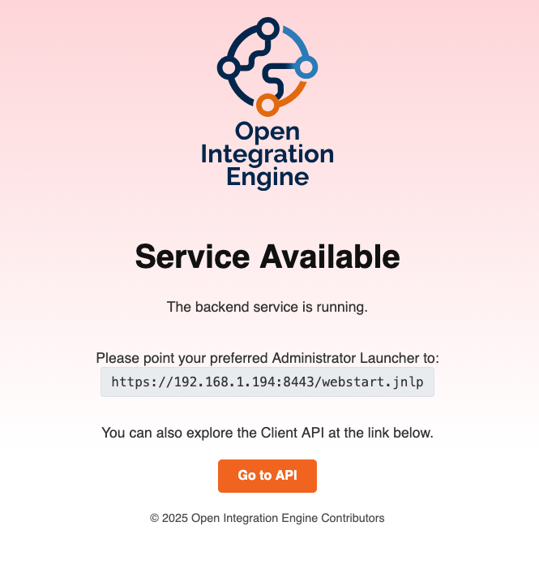
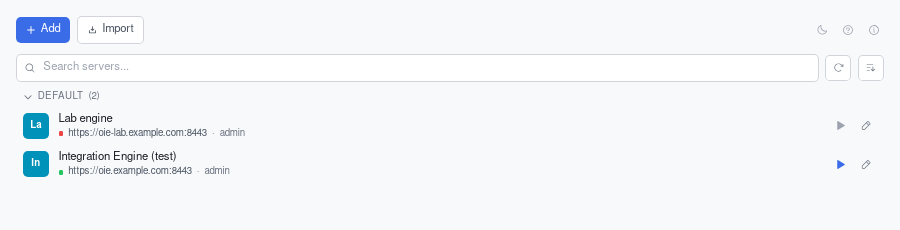
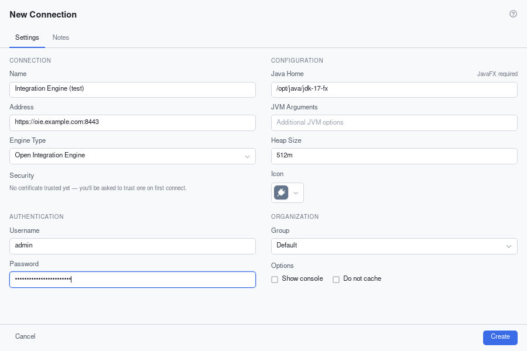
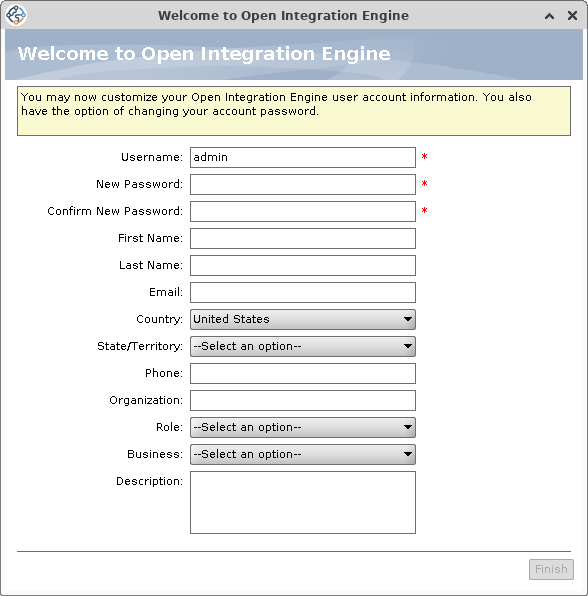
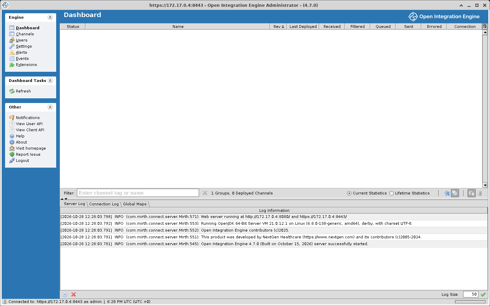

# Accessing the Administrator

To verify that the OIE server is available, open a browser and enter the URL from the startup output, `https://<host>:8443/`. See [Server Process Management](./server_process_management.md) if it is not up yet.

After accepting the self-signed certificate in your browser, you will see this page:



From here there are two ways to administer the engine: a browser, or the desktop Administrator.

## Web Administrator

The Web Administrator is a browser-based administrator, developed separately from the engine as [oie-web-client](https://github.com/gibson9583/oie-web-client). It works read/write against the same REST API as the desktop client, covering channel editing, deployment, and the message browser. No launcher is involved.

It runs in one of three ways: as a standalone Node.js app, as a Docker container, or inside the engine's own web server. For the last, install the [Web Support](https://github.com/gibson9583/oie-web-support-plugin) community extension by Chris Gibson as you would any other extension (see the [plugin guide](./plugins.md)), restart the engine, and open `https://<host>:8443/oie-webadmin/`. See [Web Administrator](./web_administrator.md) for what it covers and which engine versions it supports.

## Desktop Administrator

The desktop Administrator is a Java application and needs a launcher to start it. Copy the Administrator Launcher URL from the page above, then use Launcher, below. See [Launchers](/launchers/) for more about it, and [Desktop Administrator](./desktop_administrator.md) for a tour of the client.

### Launcher

[Launcher](https://github.com/diridium-com/launcher/releases) is an open-source Administrator launcher for Open Integration Engine, built on Tauri and released under MPL-2.0. It is a fork of Ballista.



Add a connection with the engine's address, `https://<host>:8443`, and the Java home of a JavaFX-enabled JDK, then double-click the connection or click its play button to start the Administrator.



## Initial admin password

A new database has one user, `admin`. Unless `server.initialadminpassword` in `conf/mirth.properties` is set before the server first starts, the server generates a random password for it and writes it once, at WARN level, to the console and to `logs/mirth.log`:

```log
WARN  ... com.mirth.connect.server.Mirth:
********************************************************************************
************   Initial admin password is Aa1!xxxxxxxxxxxxxxxxxxxx   ************
********************************************************************************
```

The generated password is 24 characters long and starts with `Aa1!`. `server.initialadminpassword` is read only when the database is created.

A database that already exists, after an upgrade or a migration from Mirth Connect, keeps its users and their passwords.

The CLI's shipped `conf/mirth-cli-config.properties` contains `user=admin` and `password=admin`. Put the real password there, or pass it with `-p`. See [Command Line Interface](./command_line_interface.md#configuration).

## Logging in

Enter your credentials and click `Login` when the login screen appears. After a brief loading screen, you will see the OIE dashboard.

### First login

In the desktop Administrator, every user's first login opens a dialog titled **Welcome to Open Integration Engine** before the dashboard.



Enter a password in `New Password` and `Confirm New Password`, then click `Finish`. `Finish` stays disabled until both are filled in, and the server refuses a password that does not meet the [password policy](./user_management.md#password-policy), which with the shipped settings means at least 15 characters. The other fields are optional. Closing the dialog logs you out.



::: warning Every account is an administrator
All users are administrators by default, with privilege to write and execute channel scripts on the server. Grant access only to users who should be able to author and execute scripts, or install an RBAC plugin to create low-privileged roles.

[Role Based Access Control](https://github.com/diridium-com/role-based-access-control) is a community extension that replaces the default authorization controller with roles and per-channel grants, and it works in both administrators.
:::
