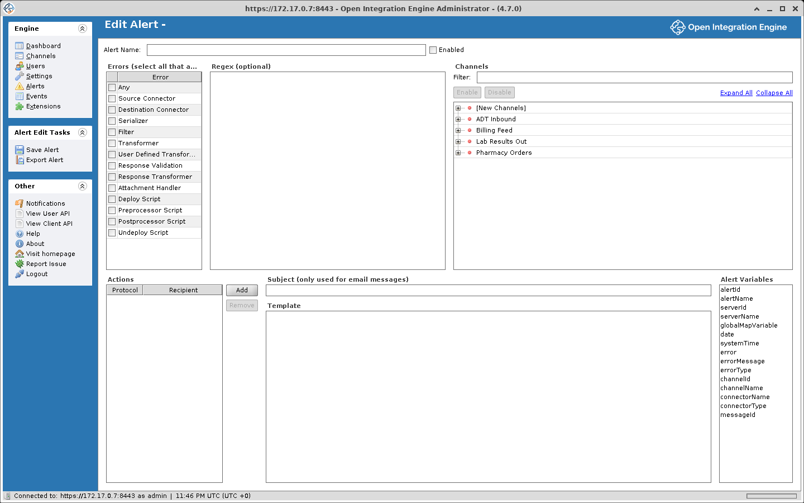

# Alerts and Notifications

An alert watches for chosen categories of errors on the channels and connectors you select. When a matching error occurs, the alert runs all of its actions: sending emails, notifying users, or dispatching a message to a designated channel.

## How alerts work

The **Alerts** view in the main navigation shows a summary table of all configured alerts:

| Column | Description |
|---|---|
| **Status** | Whether the alert is currently enabled or disabled |
| **Name** | The alert name |
| **Id** | The alert's unique identifier |
| **Alerted** | How many times the alert has fired since it was last enabled |

## Creating and editing an alert

Click **New Alert** in the Alerts task panel, or select an existing alert and click **Edit Alert** (you can also double-click an alert row). The Edit Alert view has three main configuration areas: error types, channel selection, and actions.



### Error types and regex

Choose which categories of error trigger the alert. Select one or more:

| Error Category | What It Covers |
|---|---|
| **Any** | All error categories at once |
| **Source Connector** | Errors while the source connector receives or polls for messages, or delivers a response. A source connector that fails to start raises no alert |
| **Destination Connector** | Errors during message dispatch or response receipt |
| **Serializer** | Errors when converting a message to or from its internal representation (e.g. parsing HL7 to XML) |
| **Filter** | Errors thrown by a source or destination filter rule |
| **Transformer** | Errors thrown by a source or destination transformer step |
| **User Defined Transformer** | Errors dispatched by a manual call to `alerts.sendAlert(errorMessage)` from any script that has a channel in scope. The global deploy and undeploy scripts do not have the `alerts` object |
| **Response Validation** | Errors from destination response validation. For example, receiving an HL7 NACK |
| **Response Transformer** | Errors from a destination's response transformer step |
| **Attachment Handler** | Errors from the attachment handler |
| **Deploy Script** | Errors from a channel's deploy script |
| **Preprocessor Script** | Errors from a global or channel preprocessor script |
| **Postprocessor Script** | Errors from a global or channel postprocessor script |
| **Undeploy Script** | Errors from a channel's undeploy script |

You can optionally provide a **regex pattern** that is searched for in the full error output, a composite string that includes the error type, error source line (if available), the custom error message, and the exception stack trace. The alert fires when the pattern is found anywhere in the combined output.

### Channel and connector selection

The channel tree sets which channels and connectors the alert monitors. Individual connectors within a channel can be enabled or disabled, for example to watch only the source connector.

Two special entries are available:

- **[New Channels]**. Automatically include any channel created after the alert was set up
- **[New Destinations]**. Automatically include any new destination added to an already-monitored channel

Use the **Filter** field above the tree to search channels by name, and the **Enable** / **Disable** buttons to toggle selection in bulk.

### Actions

Each alert can have multiple actions that all fire when the alert triggers. For every action, you choose a **protocol** and a **recipient**:

| Protocol | Behavior |
|---|---|
| **Email** | Sends an email to the address specified in the Recipient column. Uses the Subject and Template fields. |
| **User** | Sends an email to the email address on file for the selected OIE user account |
| **Channel** | Dispatches the Template content as a message to the channel specified in the Recipient column. The Subject field is ignored. |

#### Subject and template

The **Subject** line (used only for email-based protocols) and the **Template** body both support alert variables and Velocity replacement syntax. You can also reference any Global Map or Configuration Map entry.

## Alert variables

These variables can be used in the Subject and Template fields:

| Variable | Description |
|---|---|
| `${alertId}` | The alert's unique ID |
| `${alertName}` | The alert's name |
| `${serverId}` | The server's unique ID |
| `${serverName}` | The configured server name (added in 4.6.0) |
| `${date}` | A Velocity DateTool object. Use `${date.get('yyyy-MM-dd HH:mm:ss')}` for formatted output |
| `${systemTime}` | The time the error occurred, as a Unix epoch value in milliseconds |
| `${error}` | The full error output including error type, source line, message, and stack trace |
| `${errorMessage}` | The exception message string, or "No exception message." if no exception is present |
| `${errorType}` | The error category (matches the categories listed above) |
| `${channelId}` | The ID of the channel where the error occurred |
| `${channelName}` | The name of that channel |
| `${connectorName}` | The name of the connector where the error occurred. Null for errors that have no connector, which include deploy, undeploy, preprocessor, postprocessor, and attachment handler errors, and `alerts.sendAlert()` called from the deploy, undeploy, or postprocessor scripts |
| `${connectorType}` | The connector protocol name (e.g. "TCP Sender", "HTTP Listener"), if available |
| `${messageId}` | The message ID associated with the error (only present when a message is involved) |

Global Map and Configuration Map entries are also available by name. For example, `${myGlobalVar}` will resolve if a matching entry exists.

### Example template

This Template body uses only variables from the table above.

```text
Channel: ${channelName} (${channelId})
Connector: $!{connectorName}
Message ID: $!{messageId}
Date: ${date.get('yyyy-MM-dd HH:mm:ss')}

${error}
```

Velocity runs in its default non-strict mode, so a reference whose variable is missing or null is written out as its own literal text, `${messageId}` for example. The `$!{messageId}` form writes nothing instead. That matters for errors with no connector (see `${connectorName}` above), and for deploy and undeploy script errors, which have no message either.

## Email configuration

For email-based alert actions to work, you need to configure the SMTP settings on the **Server** tab under **Settings**:

| Setting | Description |
|---|---|
| **SMTP Host** | Your mail server hostname |
| **SMTP Port** | The mail server port |
| **Send Timeout** | How long to wait before giving up on a connection (in milliseconds) |
| **Default From Address** | The sender address for outgoing alert emails |
| **Secure Connection** | None, STARTTLS, or SSL |
| **Require Authentication** | Whether the mail server requires a username and password |
| **Username / Password** | SMTP credentials (when authentication is enabled) |

You can test the configuration with the **Send Test Email** button.

## Managing alerts

### Alert tasks

| Task | Description |
|---|---|
| **Refresh** | Reload the alerts table |
| **New Alert** | Create a new alert and open the editor |
| **Import Alert** | Load an alert from an XML file |
| **Export All Alerts** | Save all alerts as individual XML files |
| **Export Alert** | Save the selected alert as an XML file |
| **Delete Alert** | Permanently remove the selected alert |
| **Edit Alert** | Open the selected alert in the editor |
| **Enable Alert** | Activate the alert so it begins monitoring |
| **Disable Alert** | Deactivate the alert without deleting it |

### Edit alert tasks

While editing an alert, two additional tasks are available:

- **Save Alert**. Commits your changes. If the alert is enabled, it immediately begins watching for matching errors.
- **Export Alert**. Saves the current alert to an XML file.
