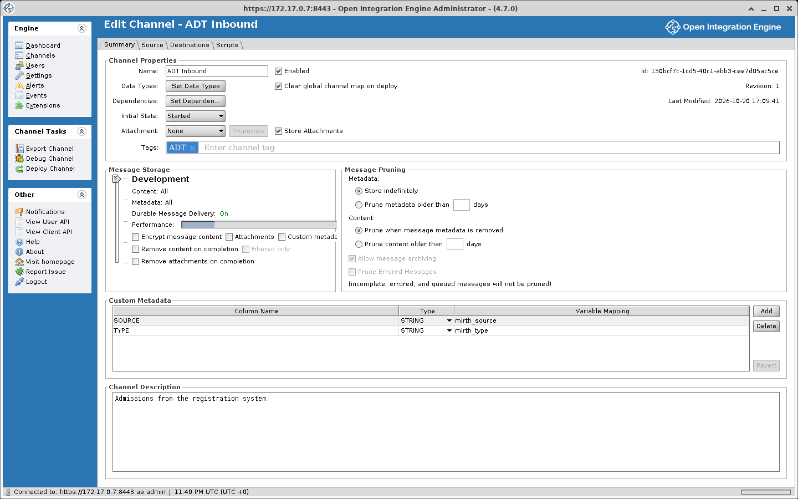
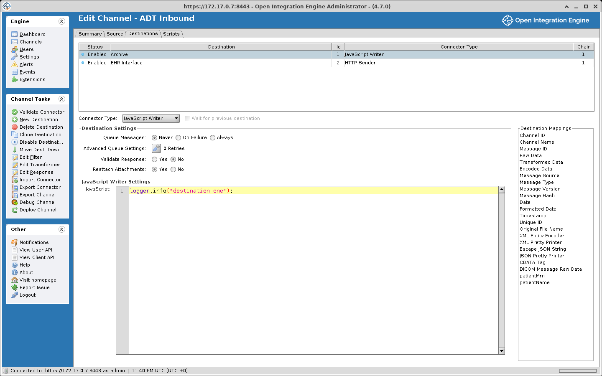

# Channels

A channel defines where data comes from and what is done with it.

## Channel lifecycle

You create and edit a channel in the channel editor. Your changes stay in the editor until you save. Saving stores the channel on the server. A saved channel does not process messages.

Deploying loads the saved channel into the engine. The scripts are compiled, the connectors are created, and **Initial State** decides whether the channel comes up started, paused, or stopped.

Start, pause, and stop apply to a deployed channel. Undeploying unloads it, and the saved channel stays on the server. Deleting removes the saved channel.

[Deploy, Start, and Channel State](./channel_state.md) has the detail.

## About channels and connectors

A channel is made up of **connectors**. There are two kinds: a **source connector** brings data into the channel, and **destination connectors** usually send it on. Neither end has to be an external system. A Channel Reader receives messages from another channel. A Channel Writer sends messages to another channel. A JavaScript Writer runs a script, which need not send the message anywhere at all. Every channel has one source connector and one or more destinations. One channel can therefore receive an HL7 message over TCP, write it to a file, and insert selected fields into a database.

```text
┌────────────────────────────────────────────────────────────┐
│                          Channel                           │
│                                                            │
│  ┌────────────┐    ┌──────────────┐    ┌──────────────┐    │
│  │   Source   │───>│   Filters    │───>│ Destination  │    │
│  │ Connector  │    │ Transformers │    │ Connector(s) │    │
│  └────────────┘    └──────────────┘    └──────────────┘    │
│                                                            │
│  Scripts: Deploy | Preprocessor | Postprocessor | Undeploy │
└────────────────────────────────────────────────────────────┘
```

The filters and transformers are drawn once here for simplicity. Every connector, source and destination alike, has its own filter and transformer; see [Connector components](#connector-components).

## General channel properties

These are configured on the Summary tab of the channel editor and cover the overall behavior of the channel. The Code Template Libraries, Library Resources and Deploy/Start Dependencies settings are on the tabs of the **Channel Dependencies** dialog, which opens from **Set Dependencies**:

- **Name and description**. The channel's unique ID is assigned automatically, not entered
- **Code Template Libraries**. Controls which reusable JavaScript functions are accessible within the channel
- **Library Resources**. Specifies which custom Java classes can be referenced by the channel's connectors or scripts
- **Deploy/Start Dependencies**. Lets you define ordering relationships between channels so certain channels come online before others
- **Attachment**. Sets the channel's attachment handler, which pulls content out of the inbound message before the preprocessor and leaves a reference in its place. The attachment is stored once, apart from the copies of content kept for each connector message. See [Attachments](./message_lifecycle.md#attachments)
- **Message Storage**. Governs what message data gets persisted, whether encryption is applied, and whether connectors can use persistent queuing
- **Message Pruning**. Defines retention periods for message data with an option to archive messages to disk before they are removed
- **Custom Metadata**. Lets you pull specific values out of messages and store them as searchable columns in the Message Browser
- **Tags**. Labels for organizing channels into logical groups



## Source connector

Each channel has exactly one source connector responsible for bringing data into OIE. Beyond the standard filter and transformer components, source connectors offer several additional features:

- **Source Queue**. Sets when the source connector responds. When it is off, the source connector responds once the message has gone through the channel, with whatever the **Response** setting picks. When it is on, the source connector stores the message, puts it on the source queue and responds straight away, and a source queue thread processes the message later. **Response** can then only be None or Auto-generate (Before processing). For example, an HL7 sender on a TCP Listener with the source queue on gets its ACK as soon as the message is stored. If a destination fails afterwards, the sender has already been told the message was accepted. See [Queueing](./queueing.md).
- **Process Batch**. When set to Yes, a single inbound payload gets broken apart into individual messages, each of which travels through the channel independently.
- **Response**. Configures what gets sent back to the system that delivered the message. Options include auto-generating a response based on the source data type, forwarding the reply from a particular destination, or providing an entirely custom response.
- **Max Processing Threads**. Defaults to 1, meaning messages go through the channel one at a time. Above 1, messages are processed in parallel and their order is not guaranteed. This setting does not affect asynchronous processes such as destination queuing.

## Destination connectors

A channel has at least one destination connector, and at least one of them has to be enabled. A script anywhere in the channel can also send data out, and a script on the source side does so before any destination is reached.



A message can reach none, some, or all of a channel's destinations. The [destination set](./glossary.md#destination-set) decides which ones it goes to, and each destination's own filter can still filter it out. Destinations have a few features beyond the standard filter and transformer:

- **Enabled**. Whether the destination takes part in processing. A disabled one is skipped entirely.
- **Wait for previous destination**. Determines which **chain** the destination belongs to (see [Destination Chains](#destination-chains) below).
- **Response Transformer**. A second transformer that runs on what the destination got back. It has its own inbound and outbound data types. Its steps can do anything a transformer step can, and it can also set the response's status, status message, and error message. It runs when the response message is not empty, so a destination that failed to connect skips it. When the response inbound data type is **Raw**, it runs either way.

## Channel scripts

Each channel has four configurable scripts that run at specific points in the lifecycle:

| Script | When It Runs |
|---|---|
| **Deploy Script** | Runs once while the channel deploys, before it starts. If it throws, the deploy fails |
| **Preprocessor Script** | Fires for each message, after the source connector receives it and after any attachment extraction, but before filtering and transformation begin. It can modify the raw message, for example to strip a byte order mark (BOM) from the front before the engine parses it. |
| **Postprocessor Script** | Fires for each message after the source and all destinations have finished (not counting asynchronous queue processing). With the source queue off, that is before the source connector sends its response. Has access to destination responses and can return a custom reply for the source to use. |
| **Undeploy Script** | Runs once while the channel undeploys, after it has stopped |

## Connector components

Every connector, whether source or destination, shares a common set of building blocks:

### General connector properties

Each connector is identified by a name and a **metadata ID**. The source connector is always named "Source" with a metadata ID of 0. Destination connectors have user-defined names and metadata IDs that start at 1 and increment from there. Renaming a destination does not change its metadata ID.

### Connector-specific properties

The configuration fields vary by connector type. See [Source Connectors](./connector_reference_sources.md) and [Destination Connectors](./connector_reference_destinations.md) for specifics.

### Filter

A filter decides whether a message goes on. Whatever you build in the filter editor becomes JavaScript, and the **Generated Script** tab shows what it built. The script must return true or false.

A filter rule can also run any code a transformer step can. It can set a map variable, reshape the message, or call a code template.

See [Filters and Transformers](./filters_and_transformers.md) for details.

### Transformer

A transformer is a list of steps that run on the message. They usually modify it, convert it between formats, or pull out values for later steps. Every transformer has an **inbound data type** and an **outbound data type**, which the engine uses to serialize the message on the way in and deserialize it on the way out. See [Filters and Transformers](./filters_and_transformers.md) for details.

## Destination chains

Chains are a byproduct of the **Wait for previous destination** checkbox on each destination.

It sits on the **Destinations** tab beside the connector type dropdown, and applies to the destination selected in the table above it. If it is checked, the destination joins the chain of the destination above it. If it is cleared, the destination starts a new chain. On the first destination it is cleared and greyed out, because the first destination always starts the first chain.

Chains run concurrently. Within a chain, destinations run one at a time, in order.

The engine builds the chains when the channel deploys, reading the destination list from top to bottom and skipping disabled destinations. Reordering the list changes the chains. So does disabling a destination: disable the one that starts a chain and the destinations below it join the chain above.

For example, with 5 destinations where Destination 3 does not wait on Destination 2 (starting a new chain):

```text
Source Connector
       │
       ▼
   Preprocessor
       │
  ┌────┴────┐
  │         │
Chain 1   Chain 2
  │         │
Dest 1    Dest 3
  │         │
Dest 2    Dest 4
  │         │
  │       Dest 5
  │         │
  └────┬────┘
       │
  Postprocessor
```

Here, Chain 1 (Dest 1 and 2) and Chain 2 (Dest 3, 4, and 5) run concurrently. If each destination takes 1 second, total processing time is 3 seconds (the longer chain) rather than 5. The source connector's filter and transformer, which run after the preprocessor and before the chains start, are left out of the diagram.

## Channel groups

Channels can be organized into **groups**. Groups have no effect on processing behavior.

- Create groups in the Channels panel
- Drag and drop channels between groups
- Deploy a whole group at once from the Channels view; to undeploy, select its channels on the Dashboard

## Channel states

| State | Description |
|---|---|
| **Started** | Channel is actively processing messages |
| **Stopped** | Channel is deployed but not processing |
| **Paused** | Channel is deployed, source is paused (queued messages still process) |
| **Undeployed** | Saved on the server, not loaded in the engine |

This table lists the states a channel rests in. The Dashboard also shows transitional states while a channel changes state. See [Deploy, Start, and Channel State](./channel_state.md#states) for the full list.

## Connector types

See [Source Connectors](./connector_reference_sources.md) and [Destination Connectors](./connector_reference_destinations.md) for every type and every setting it exposes.

Additional connectors are available as community extensions, cataloged at [openintegrationengine.org/plugins](https://openintegrationengine.org/plugins/). See the [Plugin Guide](./plugins.md) for installing them.
