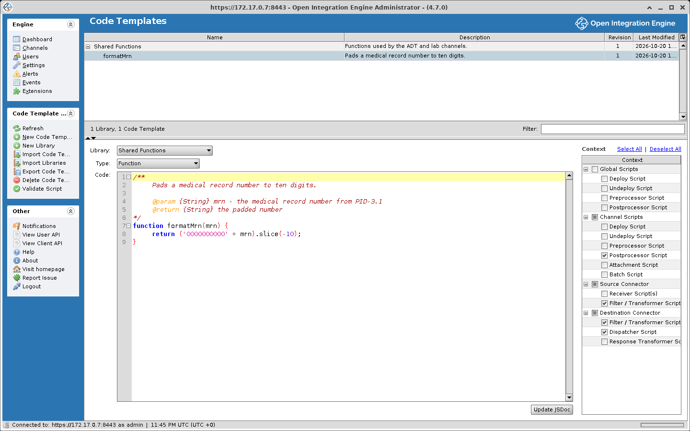

# Code Templates

Code templates are reusable code snippets and function libraries that can be shared across multiple channels.

## Overview

Code templates are organized into **libraries**. Each library is enabled for specific channels. Global scripts receive the matching templates from every library.

```text
Code Template Library
├── Code Template 1 (Function)
├── Code Template 2 (Compiled Code Block)
└── Code Template 3 (Drag-and-Drop Code Block)
```

## Managing code templates

### Code template panel
Click **Edit Code Templates** in the task panel of the **Channels** view:
- View all libraries and their templates
- Create, edit, and delete templates
- Assign libraries to channels



### Creating a library
1. Open the code templates panel with **Edit Code Templates**
2. Click **New Library**. The library is named Library 1 (then Library 2, and so on)
3. Rename the library in the tree
4. Select which channels should have access to this library

### Creating a code template
1. Select a library or a template in the tree
2. Click **New Code Template**. The template is named Template 1 (then Template 2, and so on); rename it in the tree
3. Configure:
   - **Library**: The library the template belongs to
   - **Type**: Function, Drag-and-Drop Code Block, or Compiled Code Block, plus one entry for each code template type that an installed extension adds
   - **Context**: Where it can be used (see below)
   - **Code**: The JavaScript implementation

## Template types

### Function
A named function that can be called from channel scripts. Functions are automatically added to the script context of assigned channels.

The engine parses the comment block at the top of a Function template. The text before the first `@` tag becomes the template's description, and the `@param {type} name - text` and `@return {type} text` lines supply the parameter and return details that the Reference List and the editor's auto-complete show for the function. The format the engine expects is the one below, each line indented and without a leading asterisk. It is what a new Function template starts with, and what the **Generate JSDoc** / **Update JSDoc** button in the template editor writes. With a `*` at the start of each line no `@` tag is recognized: the whole comment, asterisks included, becomes the description, and every parameter shows as type `Any` with no description. The block is stripped from the code before the function is added to channel scripts.

```javascript
/**
    Formats a patient name from HL7 components.

    @param {String} lastName - Family name, PID.5.1
    @param {String} firstName - Given name, PID.5.2
    @return {String} The name as LAST, First
*/
function formatPatientName(lastName, firstName) {
    return lastName.toUpperCase() + ', ' + firstName;
}
```

The call below runs in the source or destination transformer of a channel whose inbound data type is HL7 v2, with the template's library assigned to the channel and the Filter / Transformer context selected on the template. `msg` is the inbound message, which the engine serializes into an E4X XML object before the transformer runs (see [Message (`msg`)](./script_scope_and_user_api.md#message-msg)); the `PID.5.1` and `PID.5.2` element names exist only under HL7 v2. No outbound template is needed. `$c` is the channel map shorthand the engine adds to every script: one argument reads a key, two arguments write one.

```javascript
var patientName = formatPatientName(
    msg['PID']['PID.5']['PID.5.1'].toString(),
    msg['PID']['PID.5']['PID.5.2'].toString()
);
$c('patientName', patientName);
```

For a PID.5 of `DOE^JOHN` the channel map entry `patientName` holds `DOE, JOHN`, shown on the message in the Message Browser's Mappings tab.

### Compiled code block
A block of code that is compiled and added to the script context, similar to a function. Unlike a function, it cannot be dragged from the reference list. For example, it can hold shared initialization code or constants.

### Drag-and-drop code block
A code block that can be dragged from the reference list into the script editor. Unlike Functions and Compiled Code Blocks, Drag-and-Drop Code Blocks are **not** automatically added to the script context.

## Execution contexts

Code templates can be restricted to specific contexts. There are 15 contexts in four groups:

| Group | Context |
|---|---|
| **Global Scripts** | Deploy Script |
| **Global Scripts** | Undeploy Script |
| **Global Scripts** | Preprocessor Script |
| **Global Scripts** | Postprocessor Script |
| **Channel Scripts** | Deploy Script |
| **Channel Scripts** | Undeploy Script |
| **Channel Scripts** | Preprocessor Script |
| **Channel Scripts** | Postprocessor Script |
| **Channel Scripts** | Attachment Script |
| **Channel Scripts** | Batch Script |
| **Source Connector** | Receiver Script(s) |
| **Source Connector** | Filter / Transformer Script |
| **Destination Connector** | Filter / Transformer Script |
| **Destination Connector** | Dispatcher Script |
| **Destination Connector** | Response Transformer Script |

A template is available only in the contexts selected for it.

## Library assignment

A library applies to the channels it is assigned to. The assignment does not apply to global scripts, which receive the matching Function and Compiled Code Block templates from every library.

1. Select the library in the tree
2. Check the channels that should have access
3. Check **[New Channels]** to include every channel not explicitly unchecked, including channels created or imported later
4. Save and redeploy affected channels

A channel's own assignments are also editable from the channel editor: **Set Dependencies** opens the Channel Dependencies dialog, whose **Code Template Libraries** tab lists every library with Select All and Deselect All links.

A change to a code template reaches a channel only when the channel is redeployed, because templates are compiled into the channel's scripts at deploy. The Dashboard highlights **Rev Δ** for a channel whose code templates have changed since it was deployed.

## Import / export

### GUI
- Right-click a library or template to export as XML
- Use **Import** to load from XML files

### CLI
These commands are typed at the prompt of the CLI shell, which connects to a running server (see [Launching the CLI](./command_line_interface.md#launching-the-cli)); they are not operating-system commands. `path` is quoted when it contains spaces. Each command is described under [Code templates](./command_line_interface.md#code-templates) on that page.

```text
codetemplate library list [includecodetemplates]
codetemplate list
codetemplate import "path" [force]
codetemplate library import "path" [force]
codetemplate export id|name "path"
codetemplate library export id|name|* "path"
codetemplate remove id|name
codetemplate library remove id|name|*
```

## Reference list

The script editor has a **Reference List** panel that lists:
- Available code template functions
- Built-in utility functions (`ChannelUtil`, `DateUtil`, `FileUtil`, etc.)
- Variable references (`msg`, `tmp`, `channelMap`, etc.)
- Example code snippets

See [Reference list](./javascript_editor.md#reference-list) on the JavaScript Editor page.
