# Destination connectors

A channel has at least one destination and may have many. Each has its own filter, transformer, and connector, and it does not have to send anything: its filter can stop the message, and a JavaScript Writer may only run a script. Eleven types ship with the engine.

| Connector | Sends data by |
|---|---|
| [Channel Writer](#channel-writer) | Handing the message to another channel on the same engine |
| [Database Writer](#database-writer) | Running a statement against a JDBC database |
| [DICOM Sender](#dicom-sender) | Opening a DICOM association to a remote AE |
| [Document Writer](#document-writer) | Rendering a PDF or RTF |
| [File Writer](#file-writer) | Writing to a local directory, FTP, SFTP, S3, SMB, or WebDAV |
| [HTTP Sender](#http-sender) | Making an HTTP request |
| [JavaScript Writer](#javascript-writer) | Running a script |
| [JMS Sender](#jms-sender) | Publishing to a JMS queue or topic |
| [SMTP Sender](#smtp-sender) | Sending email |
| [TCP Sender](#tcp-sender) | Opening a TCP connection, MLLP included |
| [Web Service Sender](#web-service-sender) | Calling a SOAP operation |

## Settings outside the connector's own fields

One block sits above the connector's own configuration, and every destination type has it. It controls the queue and what happens when a send fails. **Queue Messages**, **Validate Response** and **Reattach Attachments** are on the panel itself; the rest open from the wrench button beside **Advanced Queue Settings**. The queue-only settings are greyed out while **Queue Messages** is Never, and the retry settings stay available for Never and On Failure.

| Setting | Default | Description |
|---|---|---|
| **Queue Messages** | Never | Never, On Failure, or Always. Decides whether a failed send, or every send, goes to this destination's queue. Not every failure queues: a refused connection does, but a JavaScript Writer script that throws gives ERROR and is not queued; return `QUEUED` from the script to queue the message. On Failure sends directly only while the queue is empty; otherwise a new message joins the queue. See [Queueing](./queueing.md) |
| **Retry Count Before Queue/Error** | 0 | Retries after the first failed attempt before the message queues or errors, so 0 means one attempt. Enabled only when **Queue Messages** is Never or On Failure |
| **Retry Interval (ms)** | 10000 | Wait between those attempts. Enabled when the queue is on or **Retry Count Before Queue/Error** is above 0 |
| **Rotate Queue** | No | Move a failing message to the back of the queue instead of blocking behind it. Queue on only |
| **Queue Threads** | 1 | Threads draining the queue. More than one drains it in parallel, so order is no longer guaranteed except within a **Thread Assignment Variable** group. Queue on only |
| **Thread Assignment Variable** | | Groups messages onto the same queue thread, so ordering is kept within a group when **Rotate Queue** is No. Enabled only when **Queue Threads** is above 1 |
| **Queue Buffer Size** | Default Queue Buffer Size from Settings | Messages held in memory before falling back to the database. The Administrator fills in the Settings value for a new destination and refuses to save a value of 0 or less. Queue on only |
| **Include Filter/Transformer** | No | Re-run the destination's filter and transformer on each queue retry. Enabled only when the queue is on and **Regenerate Template** is Yes |
| **Regenerate Template** | No | Replace the variables in the template and the other connector settings again on each retry, picking up map changes. Queue on only |
| **Validate Response** | No | Run the response validator of the response transformer's inbound data type on the reply. This works only when that data type has a Response Validation section; a failed validation marks the message queued or errored. For HL7 v2, an error or rejected ACK, or a control ID that does not match, gives ERROR; a blank reply, or one that is not a valid ACK, gives QUEUED, which becomes ERROR when the queue is off. Available on the Channel Writer, Database Writer, HTTP Sender, JavaScript Writer, TCP Sender, and Web Service Sender, and greyed out on the DICOM Sender, Document Writer, File Writer, JMS Sender, and SMTP Sender. The TCP Sender is the only type that ships with this on |
| **Reattach Attachments** | Yes | Re-insert attachment content before sending. No effect on the JMS Sender or the JavaScript Writer |

The queue is **off by default on every destination**.

Field values are run through [Velocity replacement](./velocity_variable_replacement.md) before the send, so a directory, a filename, a URL, a subject line, or a header can carry data from the message. The JavaScript Writer is the exception: it has no templated fields.

## Channel Writer

Hands the message to another channel on the same engine. A Channel Reader is the usual receiver, but the target channel's source does not have to be one: a channel with an HTTP Listener source receives the message and runs its destinations.

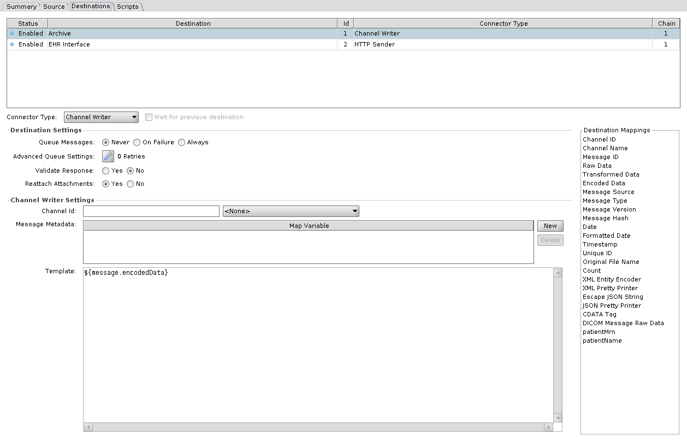

| Setting | Default | Description |
|---|---|---|
| **Channel Id** | none | The receiving channel |
| **Template** | `${message.encodedData}` | What the receiving channel gets as its raw message |
| **Message Metadata** | | Map variables to pass along. They arrive in the receiving channel's **source map**, not its channel map |

## Database Writer

Runs an insert, update, or delete against a database. Write it in SQL or build it in JavaScript.

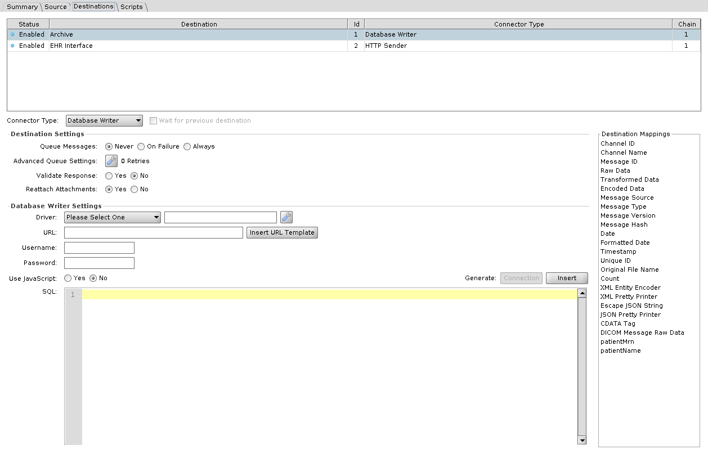

| Setting | Default | Description |
|---|---|---|
| **Driver** | Please Select One | JDBC driver. Required, JavaScript mode included. See [drivers and URL templates](./connector_reference_sources.md#jdbc-drivers-and-url-templates) |
| **URL** | | JDBC connection URL |
| **Username** / **Password** | | Database credentials |
| **Use JavaScript** | No | Build the statement in JavaScript instead of SQL |
| **SQL** / **JavaScript** | | The statement. The **Generate** buttons above it build a starting statement, or in JavaScript mode a connection block, from the settings above. In SQL mode each `${}` is bound as a parameter rather than pasted in as text; see [Where Velocity is used](./velocity_variable_replacement.md#where-velocity-is-used) |

**JavaScript mode**

As on the [Database Reader](./connector_reference_sources.md#database-reader), the connector opens no database connection in this mode and the script opens its own. **Driver** is required either way. While it reads *Please Select One* the Administrator saves the channel disabled and shows an error dialog listing the problem. **URL** is validated only when Use JavaScript is No, and the credentials are never validated. **Generate: Connection**, enabled only in this mode, pastes all four values, the password in plain text among them, into a connection block at the top of the script, and **Generate: Insert** inserts a `dbConn.executeUpdate(...)` line at the caret for the table you pick. Those values are string literals in the script from then on. Editing the fields does not change them, and the connector's own copies are never read at runtime.

The generated block opens a connection and closes it in a `finally`, with nothing in between until you add the statements yourself. What the script returns decides the response: nothing at all is a SENT with *Database write success*, a `Response` is used as-is, a `Status` sets only the status, and anything else becomes the response data.

Clicking the **Use JavaScript** radio rewrites the script field: Yes replaces its contents with the generated block, No empties it. Reopening a saved channel does not.

## DICOM Sender

Opens an association to a remote application entity and sends the message as DICOM.

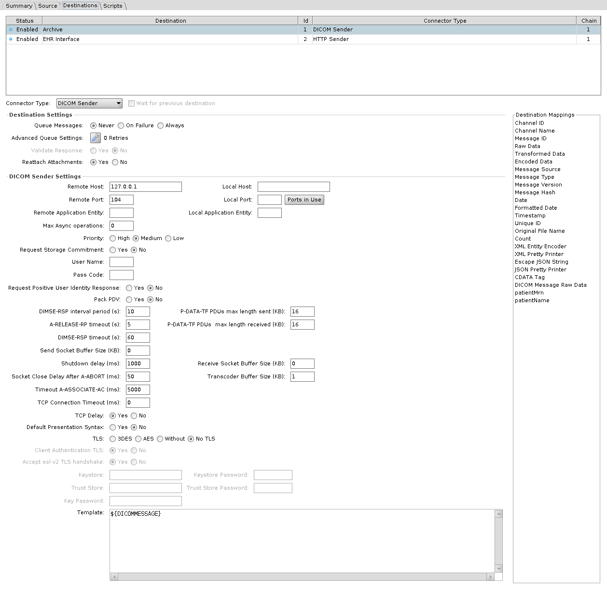

| Setting | Default | Description |
|---|---|---|
| **Remote Host** | 127.0.0.1 | Destination host |
| **Remote Port** | 104 | Destination port |
| **Remote Application Entity** | | AE title being called. Blank calls `DCMRCV` |
| **Local Host** / **Local Port** / **Local Application Entity** | | **Local Application Entity** is the AE title the connector calls with. In 4.7.0 **Local Host** and **Local Port** do not change the connection's source address or port: set to 127.0.0.2 and 7795, or either one alone, the connection still comes from 127.0.0.1 on an ephemeral port |
| **Template** | `${DICOMMESSAGE}` | Content sent |
| **User Name** / **Pass Code** | | Credentials for user identity negotiation. **Pass Code** is effective only with a **User Name** |
| **Request Positive User Identity Response** | No | Require the remote AE to confirm the identity. Effective only with a **User Name** |
| **Request Storage Commitment** | No | Ask for a storage commitment after the send |
| **Priority** | Medium | High, Medium, or Low. Sets the priority field of the C-STORE request. In 4.7.0 Medium sends 0, Low sends 1 and High sends 2, while the DICOM standard defines 0 as medium, 1 as high and 2 as low, so High and Low are swapped on the wire |
| **Max Async operations** | 0 | Maximum outstanding operations invoked asynchronously. Unlimited by default |
| **Pack PDV** | No | Pack command and data PDVs into one P-DATA-TF PDU |
| **Default Presentation Syntax** | No | Offer the default transfer syntax in its own presentation context |
| **TCP Delay** | Yes | Leave Nagle's algorithm on |

**Timing**

| Setting | Default | Description |
|---|---|---|
| **TCP Connection Timeout (ms)** | 0 | Connect timeout. 0 waits indefinitely |
| **Timeout A-ASSOCIATE-AC (ms)** | 5000 | Wait for the association to be accepted |
| **DIMSE-RSP timeout (s)** | 60 | Wait for a DIMSE response |
| **DIMSE-RSP interval period (s)** | 10 | Interval for the association reaper |
| **A-RELEASE-RP timeout (s)** | 5 | Has no effect in 4.7.0: the value is passed to the DICOM library, which never reads it |
| **Socket Close Delay After A-ABORT (ms)** | 50 | Delay before closing after an abort |
| **Shutdown delay (ms)** | 1000 | Delay before the listening socket is closed |

**Buffers**

| Setting | Default | Description |
|---|---|---|
| **P-DATA-TF PDUs max length sent (KB)** | 16 | Maximum PDU length sent |
| **P-DATA-TF PDUs max length received (KB)** | 16 | Maximum PDU length accepted |
| **Send Socket Buffer Size (KB)** | 0 | 0 leaves the OS default |
| **Receive Socket Buffer Size (KB)** | 0 | 0 leaves the OS default |
| **Transcoder Buffer Size (KB)** | 1 | Buffer used when transcoding |

**TLS**

| Setting | Default | Description |
|---|---|---|
| **TLS** | No TLS | No TLS, 3DES, AES, or Without. No TLS greys out every other setting in this table. With the JDK's default security settings on Java 17 and 21, 3DES, AES and Without fail; see the box under [DICOM Listener](./connector_reference_sources.md#dicom-listener) |
| **Client Authentication TLS** | Yes | Enable client authentication for TLS |
| **Accept ssl v2 TLS handshake** | Yes | Yes removes the SSLv2Hello handshake from the connector's protocols, so the label reads opposite to its effect |
| **Keystore** / **Keystore Password** / **Key Password** | | Identity presented to the remote AE |
| **Trust Store** / **Trust Store Password** | | Certificates this connector will trust |

With TLS on, fill in **Keystore** and **Trust Store**: left blank, the sender falls back to the DICOM library's sample paths, `resource:tls/test_sys_1.p12` and `resource:tls/mesa_certs.jks`, which the 4.7.0 release does not ship.

## Document Writer

Renders the message as a document and writes it out.

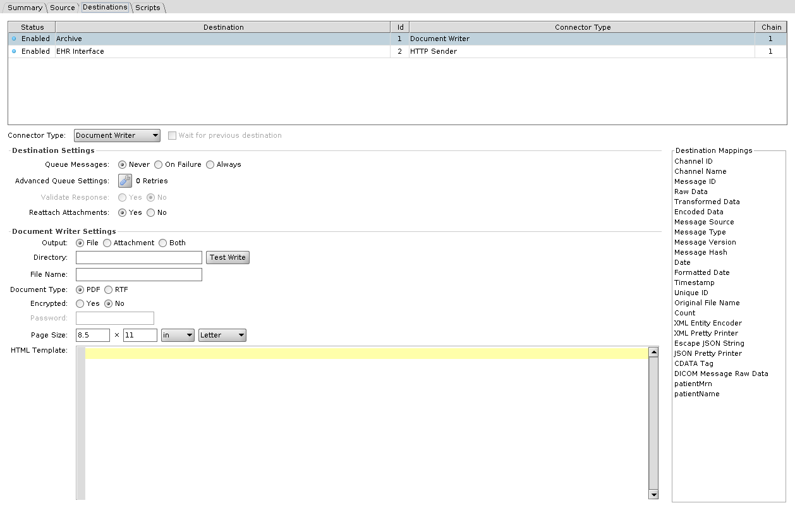

| Setting | Default | Description |
|---|---|---|
| **Output** | File | File, Attachment, or Both. Attachment and Both attach the rendered document to the message, and the destination's response contains the attachment Id. Attachment greys out **Directory**, **File Name**, and **Test Write** |
| **Directory** | | Where the file goes. **Test Write** checks that the directory can be written |
| **File Name** | | Name of the file written |
| **Document Type** | PDF | PDF or RTF |
| **Encrypted** | No | Encrypt the PDF. RTF greys this out |
| **Password** | | Password on the encrypted PDF. Enabled, and required, only when **Encrypted** is Yes |
| **Page Size** | 8.5 x 11 inches | Width, height, and unit, with a drop-down of standard page sizes beside the unit. Width and height must be above 0, and PDFs enforce a minimum of 26 mm |
| **HTML Template** | | The HTML rendered into the document |

## File Writer

Writes the message to a file. **Method** is the first choice: it decides how the location is addressed, whether credentials apply, which connection fields are available, and which **File Exists** options you get.

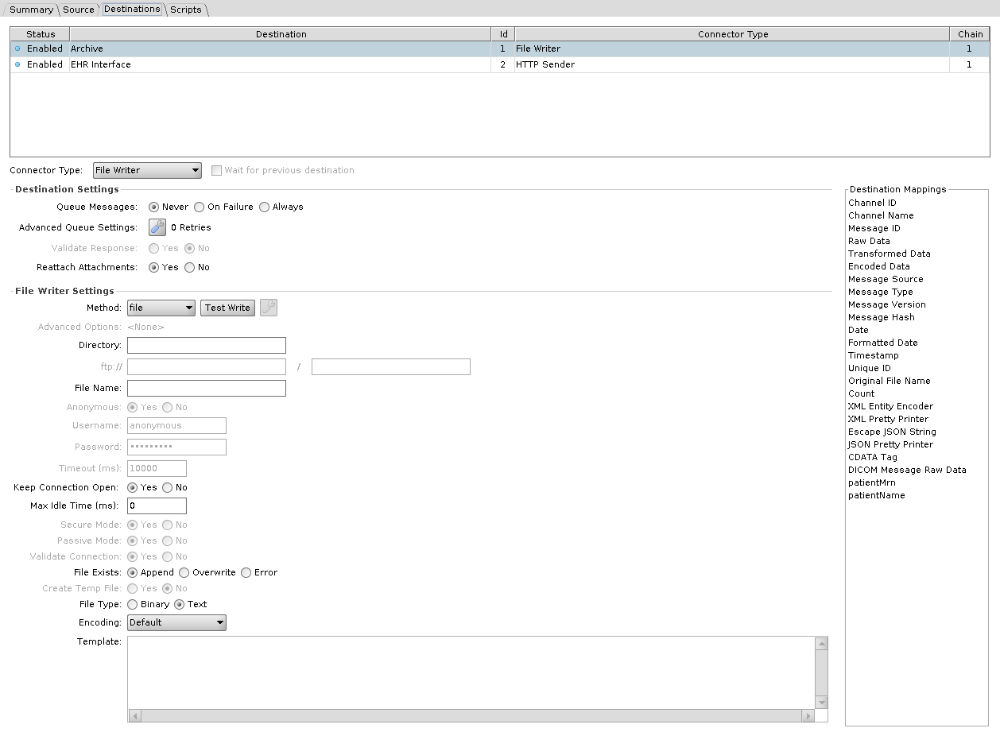

### Method

| Method | Location | Credentials | Also enables |
|---|---|---|---|
| **file** | **Directory**, a single field | none | nothing |
| **ftp** | `ftp://` host, then a path | Anonymous, or a username and password | Passive Mode, Validate Connection, Timeout, Advanced Options |
| **sftp** | `sftp://` host, then a path | A username always, and a password unless the Advanced Options use a different authentication | Timeout, Advanced Options |
| **Amazon S3** | **S3 Bucket**, then a path | Anonymous, or an AWS Access Key ID and Secret Access Key. Neither is required when the Advanced Options use the default credential provider chain | Timeout, Advanced Options |
| **smb** | `smb://` host, then a path | always required | Timeout, Advanced Options |
| **webdav** | `http://` or `https://` host, then a path | Anonymous, or a username and password | Secure Mode |

Two methods restrict what else you can choose. **Append is not available under S3 or WebDAV**, so File Exists offers only Overwrite and Error, and selecting either method switches an existing Append setting to Overwrite. S3 additionally forces **Create Temp File** to No. Under S3 the credential fields are relabelled **AWS Access Key ID** and **AWS Secret Access Key**.

::: danger Broken in 4.7.0
A File Writer set to **webdav** writes nothing: the message is left at RECEIVED, and the server log shows `NoClassDefFoundError: org/jdom/input/DOMBuilder`. Fix proposed in [engine PR #546](https://github.com/OpenIntegrationEngine/engine/pull/546), not yet in a release.
:::

On Windows, **Directory** under `file` can be a UNC path such as `\\server\share\outbound`. The Administrator stores it with forward slashes, `//server/share/outbound`, which Windows still reads as the same share. The account the OIE service runs as needs access to the share. On Linux, mount the share, in `/etc/fstab` or with an automounter, and point the `file` method at the mount point.

| Setting | Default | Description |
|---|---|---|
| **Timeout (ms)** | 10000 | How long to wait when connecting |
| **Keep Connection Open** | Yes | Keep the connection open after writing |
| **Max Idle Time (ms)** | 0 | Idle time before a kept connection is closed. 0 is infinite. Enabled only when **Keep Connection Open** is Yes |
| **Secure Mode** | Yes | WebDAV over HTTPS |
| **Passive Mode** | Yes | FTP passive transfers |
| **Validate Connection** | Yes | Test the connection before writing |

Per-protocol extras sit behind **Advanced Options**; see [file protocol advanced settings](./connector_reference_sources.md#file-protocol-advanced-settings).

### Writing the file

| Setting | Default | Description |
|---|---|---|
| **File Name** | | Name of the file written |
| **File Exists** | Append | Append, Overwrite, or Error when the file is already there. Append is unavailable under S3 and WebDAV |
| **Create Temp File** | No | Write under a temporary name and rename on completion. Not available under S3, and greyed out and set to No whenever **File Exists** is Append |
| **File Type** | Text | Text or Binary. Binary base64 decodes the content before writing |
| **Encoding** | Default | Character set, Text only |
| **Template** | | Content written |

## HTTP Sender

Makes an HTTP request and treats the reply as the response.

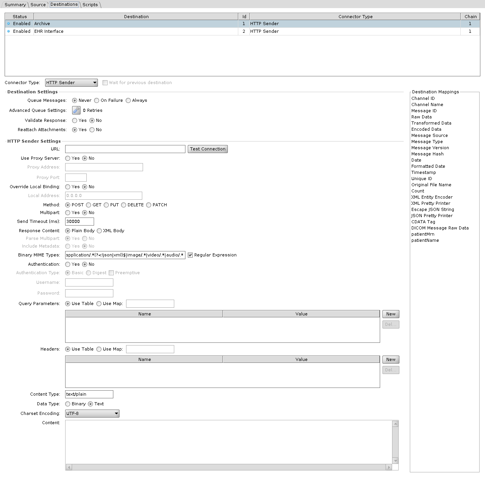

| Setting | Default | Description |
|---|---|---|
| **URL** | | Address the request goes to |
| **Method** | POST | POST, GET, PUT, DELETE, or PATCH |
| **Content** | | Request body. Enabled only for POST, PUT, and PATCH, and greyed out when **Content Type** is `application/x-www-form-urlencoded` |
| **Content Type** | text/plain | Value of the request's Content-Type header. Enabled only for POST, PUT, and PATCH. With `application/x-www-form-urlencoded`, the query parameters are encoded into the request body |
| **Data Type** | Text | Text or Binary. Binary base64 decodes the content before sending. Enabled only for POST, PUT, and PATCH, and greyed out with `application/x-www-form-urlencoded` |
| **Charset Encoding** | UTF-8 | Character set for the body. Enabled only for POST, PUT, and PATCH, with **Data Type** Text |
| **Multipart** | No | Send the request as multipart. Enabled only for POST, and greyed out and set to No with `application/x-www-form-urlencoded` |
| **Send Timeout (ms)** | 30000 | Connect and socket timeout |
| **Headers** | | Request headers. **Use Map** takes them from a map variable instead of the table |
| **Query Parameters** | | Query string parameters, same **Use Map** option |
| **Authentication** | No | Send credentials with the request |
| **Authentication Type** | Basic | Basic or Digest. The **Preemptive** checkbox beside them is off by default and sends the authorization header with the initial request, instead of only when the server asks. With Digest, the engine answers the server's 401 challenge with a second request that carries the computed Authorization header, so the Headers table needs no Authorization entry. With **Preemptive** on, the engine reads an Authorization: Digest header from the Headers table, takes its parameters (such as realm, nonce, algorithm and qop), and sends the computed header on the first request. With **Preemptive** on and no such header, Digest behaves as with **Preemptive** off |
| **Username** / **Password** | | Credentials |
| **Use Proxy Server** | No | Route through a proxy |
| **Proxy Address** / **Proxy Port** | | The proxy |
| **Override Local Binding** | No | Bind a specific local address for the outbound connection. No uses 0.0.0.0 |
| **Local Address** | 0.0.0.0 | The local address the connection is bound to. Enabled only when **Override Local Binding** is Yes, and the value may use Velocity replacement |
| **Response Content** | Plain Body | Plain Body passes the reply body through as a raw string. XML Body returns the body as XML, and adds the status line and headers only when **Include Metadata** is Yes |
| **Parse Multipart** | Yes | Split a multipart reply into parts. XML Body only |
| **Include Metadata** | No | Include status line and headers. XML Body only |
| **Binary MIME Types** | `application/.*(?<!json\|xml)$\|image/.*\|video/.*\|audio/.*` | Reply content types treated as binary and base64 encoded. The **Regular Expression** checkbox is on by default; unchecked, enter several types separated by commas |

## JavaScript Writer

Runs a script, which can send data anywhere itself or nowhere at all. What the script returns decides the response: nothing at all is a SENT with *JavaScript evaluation successful.*, a `Response` is used as-is, a `Status` sets only the status, and anything else becomes the response data. A script that throws gives ERROR.

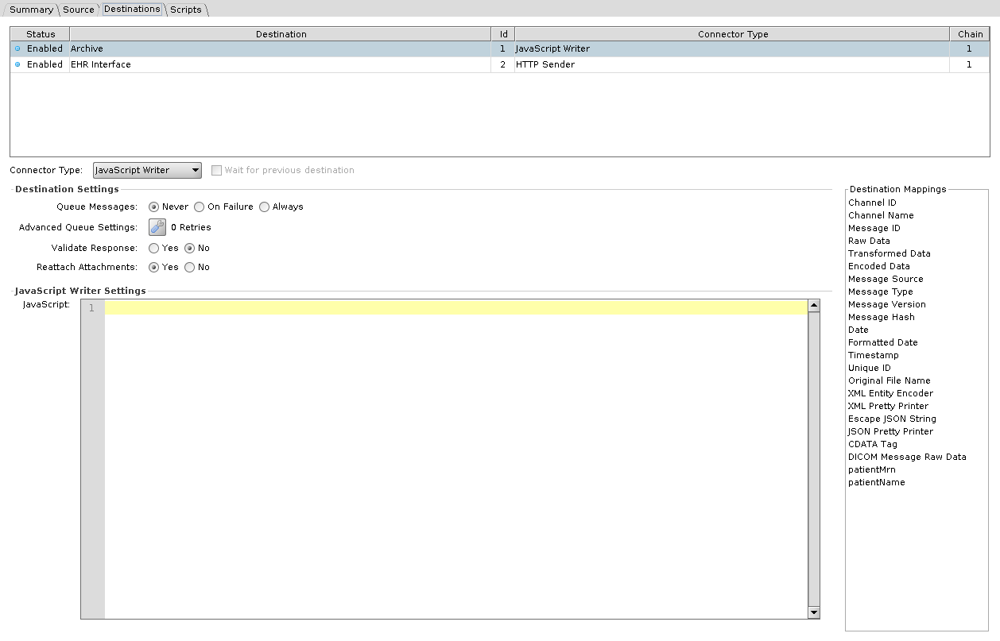

| Setting | Description |
|---|---|
| **JavaScript** | The script to run |

Unlike the JavaScript Reader, this connector has the full message scope: `channelMap`, `connectorMap`, `sourceMap`, `responseMap`, and `connectorMessage` are all available. See [Script Scope and User API](./script_scope_and_user_api.md).

## JMS Sender

Publishes to a JMS queue or topic. The connection fields are the same as the [JMS Listener](./connector_reference_sources.md#jms-listener), except that there is no **Durable** checkbox: **Use JNDI**, **Provider URL**, **Initial Context Factory**, **Connection Factory Name**, **Connection Factory Class**, **Connection Properties**, **Username**, **Password**, **Client ID**, **Destination Type**, and **Destination Name**. **Use JNDI** Yes greys out **Destination Type** and **Connection Factory Class**. No greys out **Provider URL**, **Initial Context Factory**, and **Connection Factory Name**. As for the [JMS Listener](./connector_reference_sources.md#jms-listener), select the library resource with the provider's client jars on this destination's own entry in **Set Dependencies** > **Library Resources**; without it the send is ERROR with a `ClassNotFoundException` for the factory class.

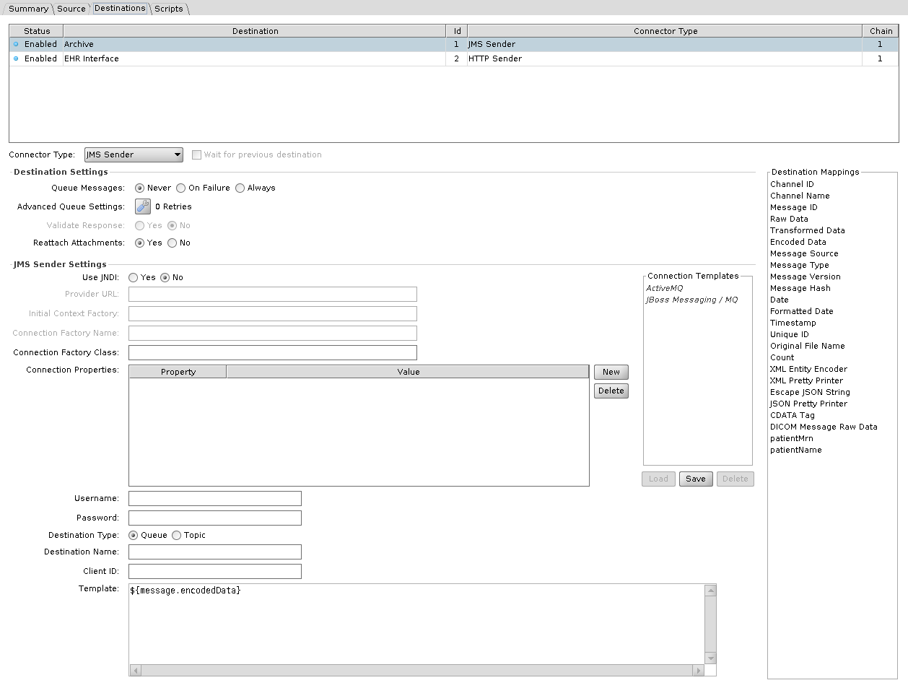

| Setting | Default | Description |
|---|---|---|
| **Template** | `${message.encodedData}` | Message body published |

## SMTP Sender

Sends email.

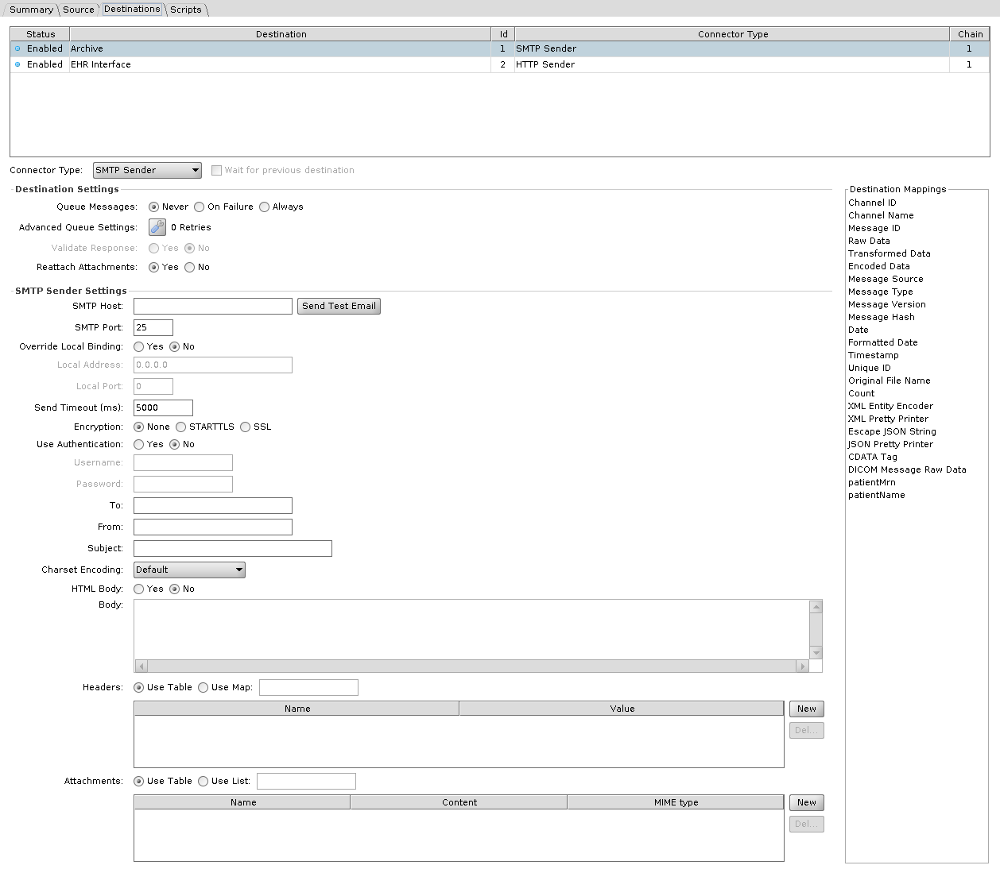

| Setting | Default | Description |
|---|---|---|
| **SMTP Host** | | Mail server |
| **SMTP Port** | 25 | Mail server port |
| **Override Local Binding** | No | Bind a specific local address and port for the outbound connection |
| **Local Address** / **Local Port** | 0.0.0.0 / 0 | The local binding. Enabled only when **Override Local Binding** is Yes |
| **Send Timeout (ms)** | 5000 | Connect and socket timeout |
| **Encryption** | None | None, STARTTLS, or SSL |
| **Use Authentication** | No | Authenticate to the server. No greys out **Username** and **Password** |
| **Username** / **Password** | | SMTP credentials |
| **To** | | Recipients, comma separated |
| **From** | | Sender address |
| **Subject** | | Subject line of the email |
| **Charset Encoding** | Default | Character set for the body |
| **HTML Body** | No | Send the body as HTML rather than plain text |
| **Body** | | Body of the email |
| **Headers** | | Additional headers. **Use Map** takes them from a map variable |
| **Attachments** | | Files attached, each with a name, content, and MIME type. **Use List** takes them from a list variable |

The Administrator has fields for **To** and **From** only. `cc`, `bcc`, and `replyTo` exist in the connector's saved properties but have no field.

## TCP Sender

Opens a TCP connection and sends the message, MLLP framing included.

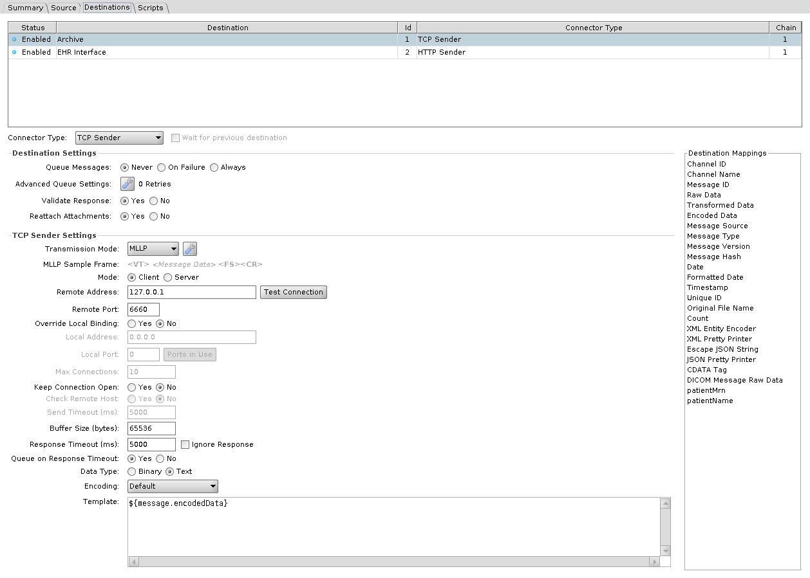

| Setting | Default | Description |
|---|---|---|
| **Mode** | Client | Client connects out, and is the only mode with **Remote Address**, **Remote Port**, **Override Local Binding**, and **Keep Connection Open**. Server binds and waits, and is the only mode with **Max Connections** |
| **Remote Address** | 127.0.0.1 | Where to connect |
| **Remote Port** | 6660 | Port to connect to |
| **Override Local Binding** | No | Bind a specific local address and port. Client mode only |
| **Local Address** / **Local Port** | 0.0.0.0 / 0 | The local binding. Enabled in Server mode, or in Client mode when **Override Local Binding** is Yes |
| **Send Timeout (ms)** | 5000 | How long to keep the connection open when **Keep Connection Open** is Yes. 0 keeps it open indefinitely. Enabled only when **Keep Connection Open** is Yes |
| **Buffer Size (bytes)** | 65536 | Applied to both the socket receive buffer and the socket send buffer, and to the output stream buffer |
| **Max Connections** | 10 | Concurrent connections accepted. Server mode only |
| **Keep Connection Open** | No | Hold the connection open between messages. Client mode only, and Yes is what enables **Send Timeout** and **Check Remote Host** |
| **Check Remote Host** | No | Test the connection is still alive before sending. Enabled only when **Keep Connection Open** is Yes |
| **Response Timeout (ms)** | 5000 | Wait for a reply. Also used as the connect timeout |
| **Ignore Response** | No | A checkbox beside **Response Timeout**. Sends without waiting for a reply, and ticking it disables **Queue on Response Timeout** |
| **Queue on Response Timeout** | Yes | Queue the message when no reply arrives, rather than erroring. Has no effect unless the destination queue is on |
| **Data Type** | Text | Text or Binary. Binary base64 decodes before sending |
| **Encoding** | Default | Character set, Text only |
| **Transmission Mode** | MLLP | MLLP or Basic TCP. **Sample Frame** previews the framing bytes. See [transmission modes](./connector_reference_sources.md#transmission-modes) |
| **Template** | `${message.encodedData}` | Content sent |

**Validate Response** is on by default for this destination.

## Web Service Sender

Calls a SOAP operation.

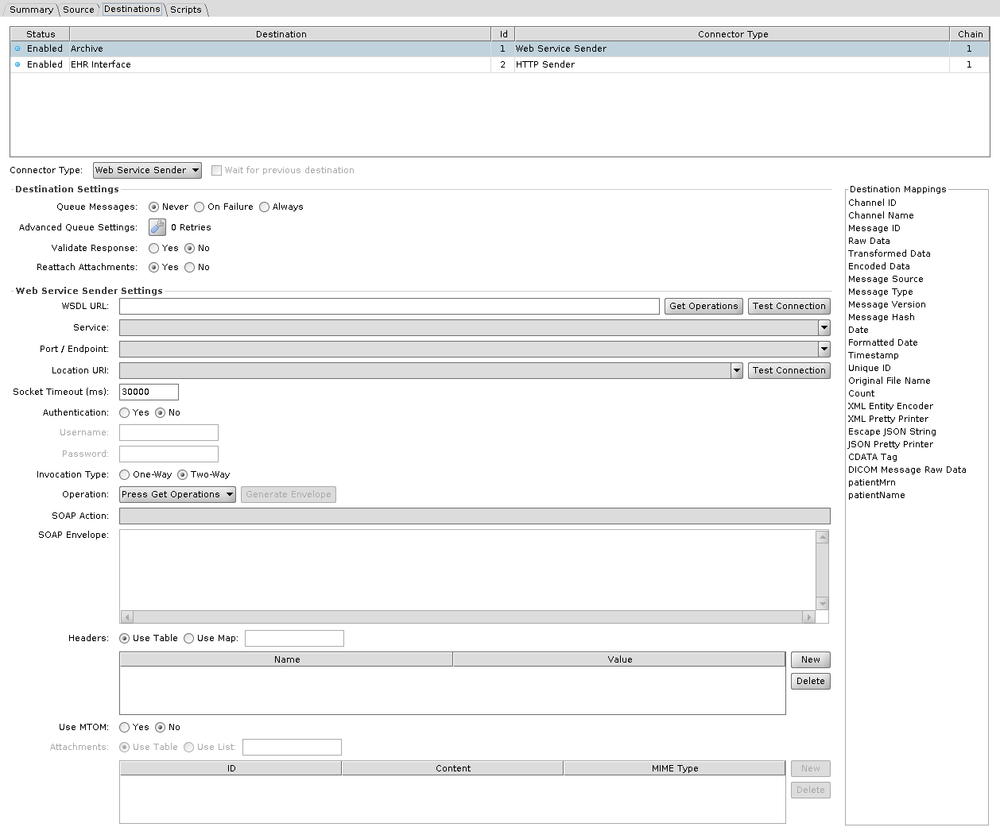

| Setting | Default | Description |
|---|---|---|
| **WSDL URL** | | WSDL to read. **Get Operations** populates the fields below from it |
| **Service** | | Service from the WSDL |
| **Port / Endpoint** | | Port from the WSDL |
| **Location URI** | | Endpoint address, when it differs from the one in the WSDL |
| **SOAP Action** | | SOAPAction header |
| **Operation** | Press Get Operations | Operation from the WSDL. Used to generate the **SOAP Envelope** and fill in **SOAP Action**, and not read when the message is sent |
| **SOAP Envelope** | | The envelope sent. Generated from the WSDL, then edited |
| **Invocation Type** | Two-Way | Two-Way waits for a response, One-Way does not |
| **Socket Timeout (ms)** | 30000 | Connection and socket timeout. 0 is infinite |
| **Authentication** | No | Send credentials with the request. They are also used to fetch the WSDL |
| **Username** / **Password** | | Credentials |
| **Headers** | | Request headers. **Use Map** takes them from a map variable |
| **Use MTOM** | No | Send attachments as MTOM |
| **Attachments** | | Attachments, each with an **ID**, **Content** (Base64 encoded), and **MIME Type**. The table is enabled only when **Use MTOM** is Yes. **Use List** takes them from a list variable |
