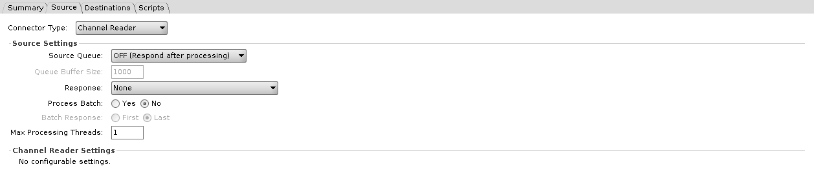
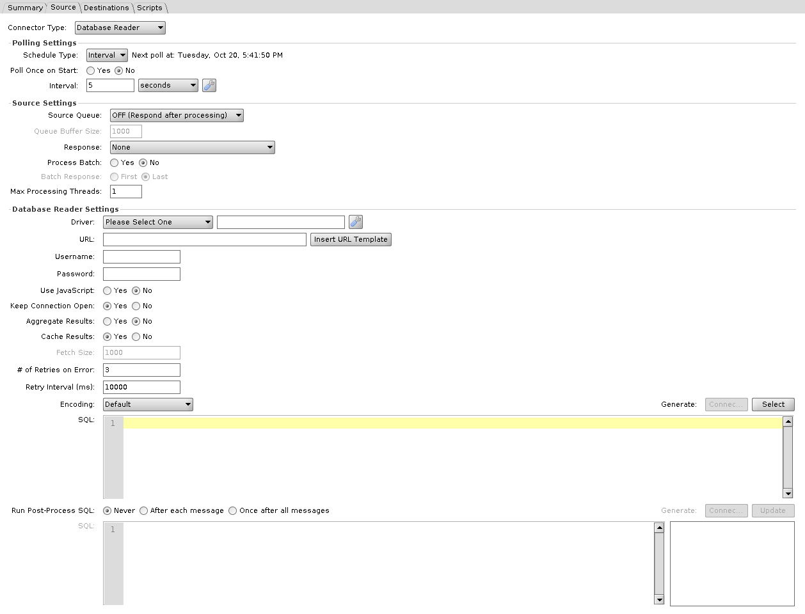
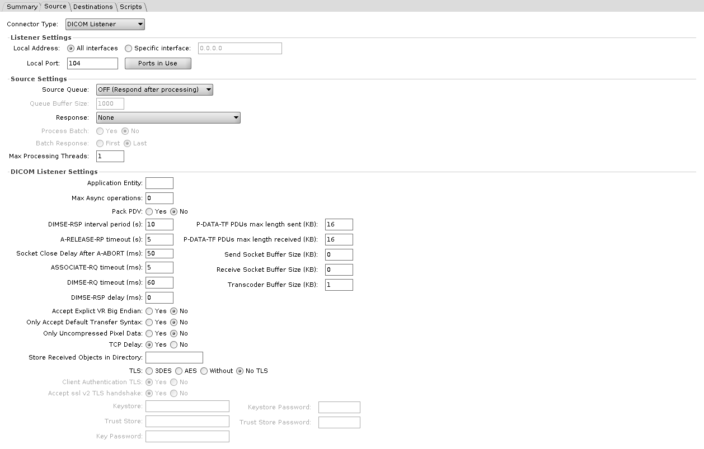
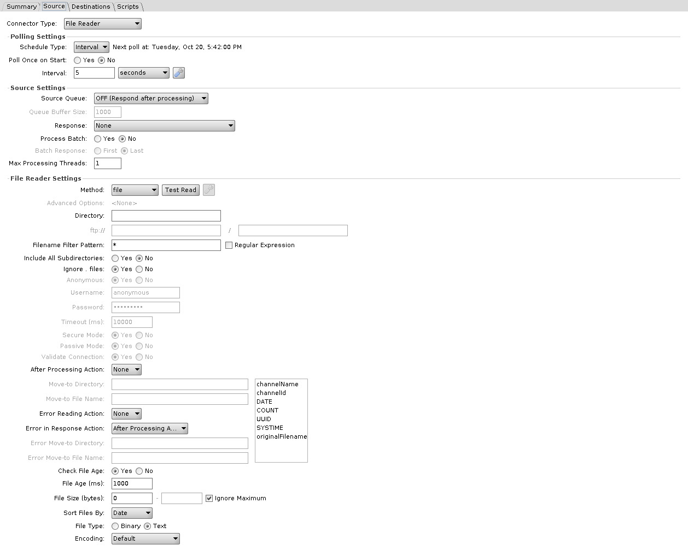
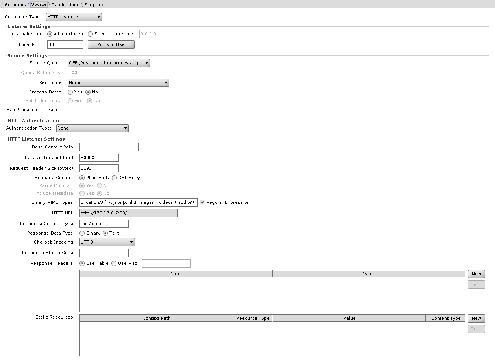
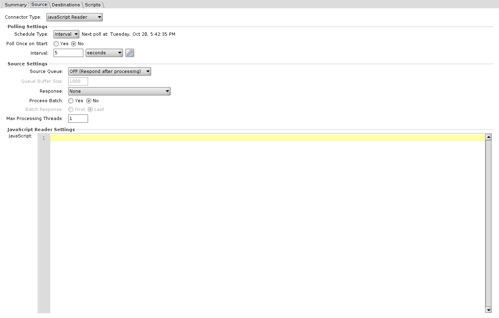
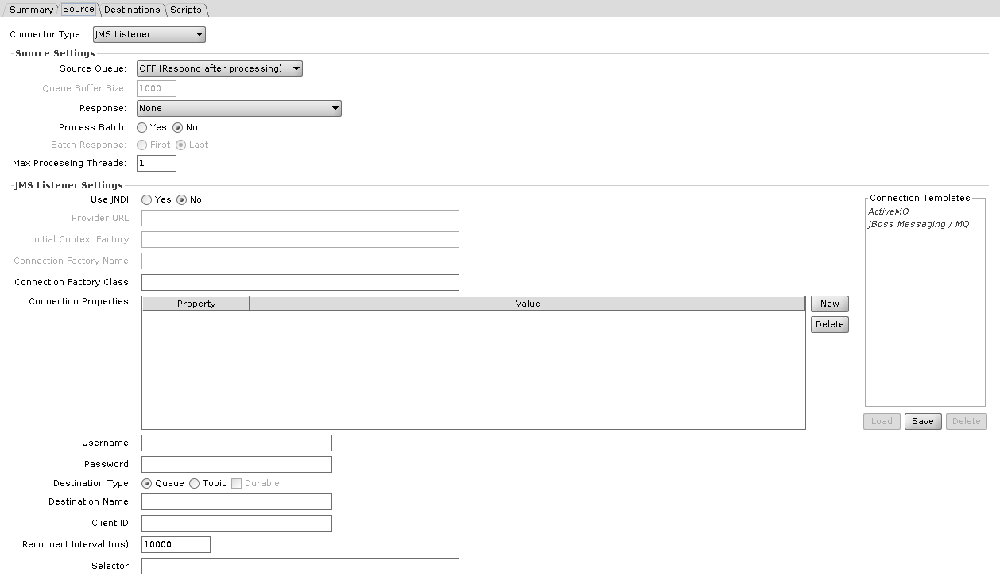
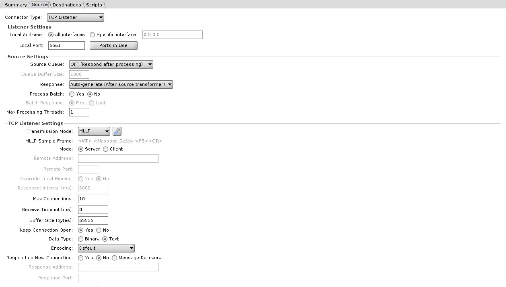
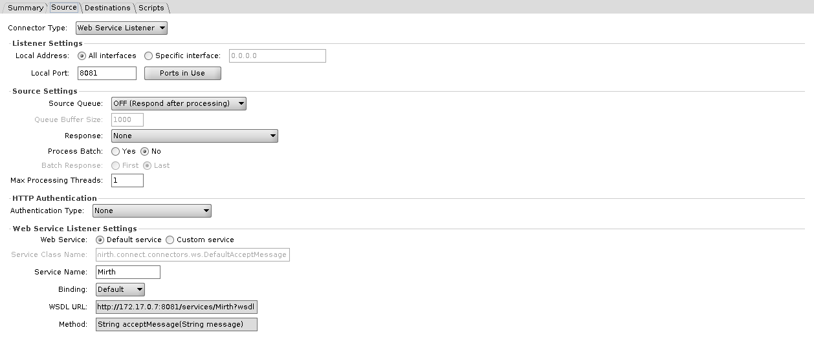

# Source connectors

A channel has exactly one source connector. Nine types ship with the engine.

| Connector | Gets data by |
|---|---|
| [Channel Reader](#channel-reader) | Receiving from other channels on the same engine |
| [Database Reader](#database-reader) | Polling a JDBC database |
| [DICOM Listener](#dicom-listener) | Accepting DICOM associations |
| [File Reader](#file-reader) | Polling a local directory, FTP, SFTP, S3, SMB, or WebDAV |
| [HTTP Listener](#http-listener) | Serving HTTP requests |
| [JavaScript Reader](#javascript-reader) | Running a script on a schedule |
| [JMS Listener](#jms-listener) | Consuming from a JMS queue or topic |
| [TCP Listener](#tcp-listener) | Accepting TCP connections, MLLP included |
| [Web Service Listener](#web-service-listener) | Serving SOAP requests |

## Settings outside the connector's own fields

Three blocks sit above the connector's own configuration, and the type decides which of them you get.

**Listener settings**, on the four listeners: TCP Listener, HTTP Listener, Web Service Listener, and DICOM Listener.

| Setting | Description |
|---|---|
| **Local Address** | **All interfaces** (the default) binds `0.0.0.0`. **Specific interface** binds the address you enter |
| **Local Port** | Port to bind. Defaults differ per connector and are given below. The **Ports in Use** button lists the listener ports the engine is already using |

**Polling settings**, on the three that poll rather than listen: Database Reader, File Reader, and JavaScript Reader. They poll on an interval, at a set time, or on a cron schedule. See [Polling Settings](./polling_settings.md).

**Source settings**, the only block all nine have: the source queue, the response selector, batch processing where the type supports it, and max processing threads. See [Architecture](./architecture_overview.md#connectors).

## Channel Reader

Receives messages from Channel Writer destinations on other channels, and from `router` calls in scripts. It has no fields of its own, and the Administrator shows **No configurable settings.** in their place. The source settings block above still applies, and what arrives is decided entirely by the sending side.



## Database Reader

Polls a database for a result set. Whether that set becomes one message or one message per row is decided by **Aggregate Results** below. Write the query in SQL or build it in JavaScript.



| Setting | Default | Description |
|---|---|---|
| **Driver** | Please Select One | JDBC driver. Required, JavaScript mode included. See [drivers and URL templates](#jdbc-drivers-and-url-templates) |
| **URL** | | JDBC connection URL |
| **Username** / **Password** | | Database credentials |
| **Use JavaScript** | No | Build the query in JavaScript instead of SQL. Switches the **SQL** field below to **JavaScript** |
| **Keep Connection Open** | Yes | Reuse the connection between polls rather than reconnecting. Unavailable in JavaScript mode |
| **Aggregate Results** | No | Yes turns the whole result set into one message, sets **Cache Results** to Yes, and greys it out. No turns each row into its own message |
| **Cache Results** | Yes | Hold the whole result set in memory before processing. No streams from the cursor instead, and is what enables **Fetch Size**. Unavailable in JavaScript mode |
| **Fetch Size** | 1000 | JDBC ResultSet fetch size used when reading from the current cursor position. **Applies only when Cache Results is No**, and is greyed out otherwise, so at the default settings it does nothing |
| **# of Retries on Error** | 3 | Attempts after a failed poll before giving up |
| **Retry Interval (ms)** | 10000 | Wait between those attempts |
| **Encoding** | Default | Character set used to convert binary column values (byte arrays and blobs) to text. Text columns are not affected |
| **SQL** / **JavaScript** | | The select. The **Generate** buttons above it build a starting statement, or in JavaScript mode a connection block, from the settings above. In SQL mode each `${}` is bound as a parameter rather than pasted in as text; see [Where Velocity is used](./velocity_variable_replacement.md#where-velocity-is-used) |
| **Run Post-Process SQL** / **Run Post-Process Script** | Never | Never, After each message, or Once after all messages. Runs a second statement after the message has been processed. With **Aggregate Results** Yes the options read For each row and Once for all rows. In JavaScript mode, After each message and For each row give the script a `resultMap` variable holding the row. Once for all rows gives it a `results` variable holding a list of maps, one per row, when the select script returned a ResultSet; when the script returned a List, the post-process does not run. Once after all messages, with **Aggregate Results** No, runs after each poll with neither variable |

The select runs again on every poll, so unless something changes the data it reads or the query itself, the same rows come back.

**JavaScript mode**

Choosing **Use JavaScript** disables three of the settings above: Keep Connection Open, Cache Results, and Fetch Size. The connector opens no database connection at all in this mode. The script opens its own, and has to return either a `ResultSet` or a `List<Map<String, Object>>`. A poll returning anything else fails. **Aggregate Results** applies only when the script returns a `ResultSet`; a returned `List` produces one message per map.

The four settings at the top of the connector still matter in this mode. **Driver** is required whether or not you use a script: the Administrator refuses to save the channel while it reads *Please Select One*, and there is no blank option. **URL** is validated only when Use JavaScript is No, and Username and Password are never validated. All four feed the generators. **Generate: Connection**, enabled only in this mode, pastes their current values, the password in plain text among them, into a connection block at the top of the script.

```javascript
var dbConn;

try {
    dbConn = DatabaseConnectionFactory.createDatabaseConnection('<driver>','<url>','<username>','<password>');

    // You may access this result below with $('column_name')
    return result;
} finally {
    if (dbConn) {
        dbConn.close();
    }
}
```

The block is not runnable as generated. `result` is never assigned, so returning it fails the poll until you add the query yourself. **Generate: Select** is what adds it: it opens a live connection using those same four settings, which makes it the one place they are checked before a deploy, and inserts a `dbConn.executeCachedQuery(...)` line at the caret for the table you pick. The Post-Process JavaScript field has its own pair of buttons that do the same with `executeUpdate`.

Once generated, the driver, URL and credentials are string literals in the script. Editing the fields afterwards does not change them, and the connector's own copies are never read at runtime.

Clicking the **Use JavaScript** radio rewrites both script fields: Yes replaces their contents with the generated block, No empties them. Reopening a saved channel does not, so this happens only while editing.

## DICOM Listener

Accepts DICOM associations and stores received objects as messages. Default port **104**.



| Setting | Default | Description |
|---|---|---|
| **Application Entity** | | AE title this listener answers to. Blank accepts any |
| **Store Received Objects in Directory** | | Has no effect. A received object becomes a message, and nothing is written to this directory |
| **Max Async operations** | 0 | Maximum outstanding asynchronous operations. 0 leaves the DICOM library's default, which the field's tooltip gives as unlimited |
| **Pack PDV** | No | Pack the command and data PDVs into a single P-DATA-TF PDU |
| **Only Accept Default Transfer Syntax** | No | Refuse anything but implicit VR little endian |
| **Only Uncompressed Pixel Data** | No | Refuse compressed transfer syntaxes |
| **Accept Explict VR Big Endian** | No | Yes does not enable big endian: it limits the listener to the implicit VR little endian transfer syntax, as described below. The label carries the engine's own spelling |
| **TCP Delay** | Yes | Leave Nagle's algorithm on. No sets `TCP_NODELAY` |

The three transfer syntax options above reset each other: Yes on **Only Accept Default Transfer Syntax** greys out the other two and sets them to No, and Yes on **Only Uncompressed Pixel Data** or **Accept Explict VR Big Endian** greys out **Only Accept Default Transfer Syntax**. In this build any Yes limits the listener to the implicit VR little endian transfer syntax. With all three at No, the listener keeps its default set of transfer syntaxes.

**Timing**

| Setting | Default | Description |
|---|---|---|
| **DIMSE-RQ timeout (ms)** | 60 | Wait for a DIMSE request. Despite the ms label, the default 60 means 60 seconds, and any other value is read as milliseconds |
| **DIMSE-RSP delay (ms)** | 0 | Artificial delay before responding |
| **DIMSE-RSP interval period (s)** | 10 | Interval for the association reaper. Despite the s label, the default 10 means 10 seconds, and any other value is read as milliseconds |
| **ASSOCIATE-RQ timeout (ms)** | 5 | Wait for an association request. Despite the ms label, the default 5 means 5 seconds, and any other value is read as milliseconds |
| **A-RELEASE-RP timeout (s)** | 5 | Has no effect in 4.7.0. The value is stored and passed to the DICOM library, but nothing reads it, so the listener does not stop waiting for a release response |
| **Socket Close Delay After A-ABORT (ms)** | 50 | Delay before closing the socket after an abort |

**Buffers**

| Setting | Default | Description |
|---|---|---|
| **P-DATA-TF PDUs max length sent (KB)** | 16 | Maximum PDU length sent |
| **P-DATA-TF PDUs max length received (KB)** | 16 | Maximum PDU length accepted |
| **Send Socket Buffer Size (KB)** | 0 | 0 leaves the OS default |
| **Receive Socket Buffer Size (KB)** | 0 | 0 leaves the OS default |
| **Transcoder Buffer Size (KB)** | 1 | Minimum buffer used to write a received object to file |

**TLS**

| Setting | Default | Description |
|---|---|---|
| **TLS** | No TLS | No TLS, 3DES, AES, or Without |
| **Client Authentication TLS** | Yes | Require a client certificate |
| **Accept ssl v2 TLS handshake** | Yes | Yes, the default, removes the SSLv2Hello handshake from the listener's protocols, so the label reads opposite to its effect |
| **Keystore** / **Keystore Password** / **Key Password** | | Identity presented by the listener |
| **Trust Store** / **Trust Store Password** | | Certificates the listener will trust |

With **TLS** set to No TLS, the client authentication, SSLv2 handshake, keystore and trust store fields are greyed out. With TLS on, fill in **Keystore** and **Trust Store**: left blank, the listener falls back to the DICOM library's sample paths, `resource:tls/test_sys_2.p12` and `resource:tls/mesa_certs.jks`, which the 4.7.0 release does not ship.

::: danger Broken in 4.7.0 on Java 17 and 21
With the JDK's default security settings, DICOM over TLS does not connect: with **TLS** set to 3DES, AES or Without, the handshake fails with `No appropriate protocol (protocol is disabled or cipher suites are inappropriate)`. No TLS works. Reported in [engine issue #556](https://github.com/OpenIntegrationEngine/engine/issues/556); no fix has been proposed yet.
:::

## File Reader

Polls a location and turns files into messages.



**Method** is the first field on the panel. It decides how the location is addressed, whether credentials apply, and which connection settings are available.

| Method | Location fields | Credentials | Connection settings enabled |
|---|---|---|---|
| **file** | **Directory** | none | none |
| **ftp** | `ftp://` host, path | Anonymous, or username and password | Timeout, Passive Mode, Validate Connection, Advanced Options |
| **sftp** | `sftp://` host, path | no Anonymous option; the fields stay editable | Timeout, Advanced Options |
| **smb** | `smb://` host, path | no Anonymous option; the fields stay editable | Timeout, Advanced Options |
| **webdav** | `http://` or `https://` host, path | Anonymous, or username and password | Secure Mode |
| **Amazon S3** | **S3 Bucket**, path | Anonymous, or AWS Access Key ID and Secret Access Key | Timeout, Advanced Options |

Timeout must not be left blank for FTP, SFTP, or SMB. `file` is the only method with a single **Directory** field; the others split the location into a host and a path, with the protocol prefix as the host's label. Secure Mode is what switches WebDAV between `http://` and `https://`. An installed extension that adds TLS to the File Reader changes the FTP prefix to `ftps://`. Under S3 the credential fields are relabelled **AWS Access Key ID** and **AWS Secret Access Key**, and the move-to fields become **Move-to S3 Bucket / Directory**.

::: danger Broken in 4.7.0
A File Reader set to **webdav** fails to start, and the server log shows `NoClassDefFoundError: org/jdom/input/DOMBuilder`. Fix proposed in [engine PR #546](https://github.com/OpenIntegrationEngine/engine/pull/546), not yet in a release.
:::

On Windows, **Directory** under `file` can be a UNC path such as `\\server\share\inbound`. The Administrator stores it with forward slashes, `//server/share/inbound`, which Windows still reads as the same share. The account the OIE service runs as needs access to the share. On Linux, mount the share, in `/etc/fstab` or with an automounter, and point the `file` method at the mount point.

The remaining settings, in the order they appear:

| Setting | Default | Description |
|---|---|---|
| **Filename Filter Pattern** | `*` | Wildcard by default; the **Regular Expression** checkbox switches it to a regex |
| **Include All Subdirectories** | No | Recurse |
| **Ignore . files** | Yes | Skip dotfiles |
| **Anonymous** | Yes | Offered by FTP, WebDAV, and S3 only. Choosing Yes disables the two fields below and refills them with `anonymous`, except under S3, which clears them |
| **Username** / **Password** | `anonymous` / `anonymous` | Both fields carry `anonymous` by default, so SFTP and SMB, which have no Anonymous option, open with it already filled in and editable. S3 starts them empty. A username is required whenever Anonymous is off, and a password is too, unless the method is SFTP and the Advanced Options use a key file. Neither is required under S3 when Use Default Credential Provider Chain is checked |
| **Timeout (ms)** | 10000 | How long to wait when connecting. Not available for `file` or WebDAV |
| **Secure Mode** | Yes | WebDAV over HTTPS. WebDAV only |
| **Passive Mode** | Yes | FTP passive transfers. FTP only |
| **Validate Connection** | Yes | Test the connection before each operation. FTP only |
| **After Processing Action** | None | None, Move, or Delete. None leaves the file in place, so the next poll reads it again |
| **Move-to Directory** / **Move-to File Name** | | Where a moved file goes. The directory is on the server the file was read from, so under **sftp** it is on the SFTP server and cannot be a directory on the OIE server. Enabled only when **After Processing Action** is Move. A blank directory leaves the file where it is, a blank file name keeps the original one, and an existing file at the destination is deleted first |
| **Error Reading Action** | None | None, Move, or Delete, for a file that could not be read. A message that errors inside the channel, for example in the preprocessor, does not count, and its file is handled as for any other message |
| **Error in Response Action** | After Processing Action | After Processing Action, Move, or Delete, for a file whose message got an error response. Not applied when batch processing is on |
| **Error Move-to Directory** / **Error Move-to File Name** | | Destination for either error action, on the same server, under the same rules. Enabled when either error action is Move |
| **Check File Age** | Yes | Skip files younger than **File Age** |
| **File Age (ms)** | 1000 | Minimum age before a file is read. Greyed out when **Check File Age** is No. Under **ftp** the engine takes the file time from the server's directory listing; a listing that gives times only to the minute, as vsftpd's does, lets a file be read up to a minute early |
| **File Size (bytes)** | 0, no maximum | Minimum and maximum a file must fall between. **Ignore Maximum** leaves the upper bound open, and is checked by default |
| **Sort Files By** | Date | Date, Name, or Size. Decides the order files are processed in |
| **File Type** | Text | Text or Binary. Binary base64 encodes the content |
| **Encoding** | Default | Character set, Text only |

::: warning A move happens on the server the file was read from
A move runs over the same connection the file was read from. Under **sftp** the move-to directory is a directory on the SFTP server, under **ftp** on the FTP server, and under **smb** a path on the same SMB server. It cannot be a directory on the OIE server, and nothing is copied back to the OIE server on the way. Only the **file** method moves files on the OIE server's own disk, because that is where it reads from. The same goes for **Error Move-to Directory**, and for the Delete actions, which delete on the remote side.

Relative paths resolve differently per method. FTP and SFTP change to the read directory first, so a path with no leading `/` is taken relative to the directory being read, and a leading `/` is absolute on the remote host. SMB resolves it against the server, so the first part of a relative path is the share name, for example `share/archive`. Under `file` a relative path resolves against the engine's working directory, not the directory being read, so use an absolute path. WebDAV paths always start from the server root. S3 reads the field as a bucket and a prefix, which is why it is labelled **Move-to S3 Bucket / Directory** and why a move can cross buckets. Backslashes typed into either move-to directory field are converted to forward slashes when the channel is saved. A move-to directory that does not exist is created.
:::

The wrench button beside **Method** opens a per-protocol dialog, and the **Advanced Options** row below it shows a read-only summary of what is set. See [file protocol advanced settings](#file-protocol-advanced-settings).

## HTTP Listener

Serves HTTP requests. Default port **80**, and the **HTTP URL** shown on the panel is built from the address of the server the Administrator is connected to, the Local Port, and the Base Context Path.



| Setting | Default | Description |
|---|---|---|
| **Base Context Path** | | Path this connector answers on. Blank means the root, not nothing. See below |
| **Receive Timeout (ms)** | 30000 | Maximum idle time for a connection |
| **Request Header Size (bytes)** | 8192 | Maximum combined size of all request headers. Larger requests are rejected with 431 Request Header Fields Too Large before the channel sees them. Template substitutions are allowed, and the value must resolve to a positive whole number, or the connector fails to start |
| **Message Content** | Plain Body | Plain Body passes the body through. XML Body wraps the body in XML, and with **Include Metadata** set to Yes it also adds the remote address, request URL, method, path, context path, parameters, and headers |
| **Parse Multipart** | Yes | Split a multipart request into parts. XML Body only |
| **Include Metadata** | No | Include method, context path, headers, and query parameters. XML Body only |
| **Binary MIME Types** | `application/.*(?<!json\|xml)$\|image/.*\|video/.*\|audio/.*` | Content types treated as binary and base64 encoded. **Regular Expression** switches it between a regex and a plain list |
| **Response Content Type** | text/plain | Value of the response's Content-Type header |
| **Response Data Type** | Text | Text or Binary. Binary base64 decodes the response before sending |
| **Charset Encoding** | UTF-8 | Character set. Disabled when **Response Data Type** is Binary |
| **Response Status Code** | | HTTP status to return. Blank returns 200, or 500 when the selected response has status ERROR |
| **Response Headers** | | Headers to return. **Use Map** takes them from a map variable instead of the table |
| **Static Resources** | | Paths served directly by the connector, each with its own content type and value, without producing a message |

The engine normalizes **Base Context Path**: a leading slash is added if you left it off, and a trailing slash is stripped, so `orders`, `/orders`, and `/orders/` all give the same context, and blank and `/` are the same thing. A listener answers its context path with the trailing slash, such as `/orders/`, and everything below it. A request to `/orders` without the slash gets a 302 redirect to `/orders/`, and a POST to `/orders` is not delivered to the channel, so send to `/orders/`. At the root it answers every request that reaches its port.

Each HTTP Listener builds its own server bound to its own host and port, so two channels cannot share a port and divide it by context path. Static resource paths are appended to the base.

Authentication is a separate plugin; see [HTTP authentication](#http-authentication).

## JavaScript Reader

Runs a script on the polling schedule. The script's return value becomes the message, a returned Java `List` produces one message per element, and returning nothing produces no message.



| Setting | Description |
|---|---|
| **JavaScript** | The script to run |

This connector's scope is narrower than most: it has no `channelMap`, `connectorMap`, `sourceMap`, `responseMap`, or `connectorMessage`, because the script runs before any message exists. The JavaScript Writer does have them. See [Script Scope and User API](./script_scope_and_user_api.md).

## JMS Listener

Consumes from a JMS queue or topic.



| Setting | Default | Description |
|---|---|---|
| **Use JNDI** | | Off names a factory class, on names a JNDI lookup |
| **Provider URL** / **Initial Context Factory** | | JNDI context, JNDI on |
| **Connection Factory Name** | | JNDI lookup name, JNDI on. Not a class name |
| **Connection Factory Class** | | Vendor `ConnectionFactory` implementation, JNDI off |
| **Connection Properties** | | Additional properties passed to the factory |
| **Username** / **Password** | | Broker credentials |
| **Destination Type** | Queue | Queue or Topic |
| **Durable** | No | Durable topic subscription. Available only when **Destination Type** is Topic, and needs a **Client ID** |
| **Destination Name** | | Queue or topic to consume from |
| **Client ID** | | JMS client identifier, set on the connection. A durable Topic subscription needs one, with **Use JNDI** on or off. The Administrator checks for it only when **Use JNDI** is off |
| **Reconnect Interval (ms)** | 10000 | Wait before reconnecting after a broker failure |
| **Selector** | | JMS message selector expression, filtering at the broker |

The provider's client jars go in a library resource (**Settings** > **Resources**). In the channel's **Set Dependencies** > **Library Resources**, select that resource on the **Source Connector** entry. Selecting it only on the **Channel** entry is not enough: the listener fails to start with `Failed to instantiate ConnectionFactory class`.

## TCP Listener

Accepts TCP connections. Default port **6661**.



| Setting | Default | Description |
|---|---|---|
| **Transmission Mode** | MLLP | MLLP or Basic TCP. **Sample Frame** previews the framing bytes. See [transmission modes](#transmission-modes) |
| **Mode** | Server | Server binds and accepts, and is the only mode with **Max Connections**. Client connects out, and is the only mode with **Remote Address**, **Remote Port**, **Override Local Binding**, and **Reconnect Interval** |
| **Remote Address** / **Remote Port** | | Where to connect, Client mode only |
| **Override Local Binding** | No | Bind a specific local address and port for the outbound connection. Client mode only |
| **Reconnect Interval (ms)** | 5000 | Wait before reconnecting, Client mode |
| **Max Connections** | 10 | Concurrent connections accepted. Server mode only |
| **Receive Timeout (ms)** | 0 | Idle timeout on a connection. It closes the connection only when **Keep Connection Open** is No; with Yes the connection stays open after the timeout. 0 waits indefinitely |
| **Buffer Size (bytes)** | 65536 | Applied to both the socket receive buffer and the socket send buffer, and to the buffered output stream of the response |
| **Keep Connection Open** | Yes | Hold the connection open between messages |
| **Data Type** | Text | Text or Binary. Binary base64 encodes the payload |
| **Encoding** | Default | Character set, Text only |
| **Respond on New Connection** | No | Yes, No, or Message Recovery. No sends the response back on the same connection |
| **Response Address** / **Response Port** | | Where the response goes. Enabled when **Respond on New Connection** is Yes or Message Recovery |

## Web Service Listener

Publishes a SOAP endpoint. Default port **8081**.

::: danger Broken in 4.7.0 on Java 19 and later
The listener answers every SOAP request with an HTTP 500, while its WSDL still loads. [Engine issue #509](https://github.com/OpenIntegrationEngine/engine/issues/509) reports this on Java 19 and later; a fix is proposed in [engine PR #508](https://github.com/OpenIntegrationEngine/engine/pull/508), not yet in a release. Until then, run the engine on Java 17, or add the `-classpath/a` line from engine issue #509 to `conf/custom.vmoptions`.
:::



| Setting | Default | Description |
|---|---|---|
| **Web Service** | Default service | **Default service** fills in the default class below and greys out **Service Class Name**. **Custom service** uses the class you name |
| **Service Class Name** | `com.mirth.connect.connectors.ws.DefaultAcceptMessage` | Class implementing the service. It must extend `com.mirth.connect.connectors.ws.AcceptMessage` directly and have a constructor that takes the Web Service Listener. If it does not, starting the connector logs an error and the default class is used instead. The default class publishes a single `acceptMessage(String)` operation |
| **Service Name** | Mirth | Last part of the endpoint path, `/services/<Service Name>`. With the default service, the WSDL names the service `DefaultAcceptMessageService` whatever this is set to |
| **Binding** | Default | Default, SOAP 1.1, or SOAP 1.2. Default publishes the service with the binding declared in the class, and SOAP 1.1 when it declares none |
| **WSDL URL** | | Display only. Shows `http://<server>:<port>/services/<Service Name>?wsdl` straight away, without a deploy, and updates as you change the port or service name |
| **Method** | `String acceptMessage(String message)` | Display only. Shows the default operation signature, or `<Custom Web Service Methods>` under Custom service |

## Shared reference

### Transmission modes

Used by both the TCP Listener and the [TCP Sender](./connector_reference_destinations.md#tcp-sender).

| Mode | Description |
|---|---|
| **MLLP** | HL7 framing: start byte `0x0B`, end bytes `0x1C 0x0D`. MLLPv2 adds configurable acknowledgement bytes |
| **Basic TCP** | Start and end bytes you choose |

### JDBC drivers and URL templates

Used by both the Database Reader and the [Database Writer](./connector_reference_destinations.md#database-writer). The list ships in `conf/dbdrivers.xml`. Once a driver list is saved from the Administrator, with the wrench button beside **Driver**, the engine uses the saved list and no longer reads the file.

| Driver | Class | URL Template |
|---|---|---|
| MySQL | `com.mysql.cj.jdbc.Driver` | `jdbc:mysql://host:port/dbname` |
| Oracle | `oracle.jdbc.driver.OracleDriver` | `jdbc:oracle:thin:@host:port:dbname` |
| PostgreSQL | `org.postgresql.Driver` | `jdbc:postgresql://host:port/dbname` |
| SQL Server/Sybase (jTDS) | `net.sourceforge.jtds.jdbc.Driver` | `jdbc:jtds:sqlserver://host:port/dbname` |
| Microsoft SQL Server | `com.microsoft.sqlserver.jdbc.SQLServerDriver` | `jdbc:sqlserver://host:port;databaseName=dbname` |
| SQLite | `org.sqlite.JDBC` | `jdbc:sqlite:dbfile.db` |

::: info
These are the databases a channel can *read from and write to*. They are not the same set OIE supports for its own message repository. See [Database Support](./database_support.md) for that. SQLite, for instance, is available to channels but is not a supported backing store for OIE itself.
:::

### File protocol advanced settings

Reached through the wrench button beside **Method** on the File Reader and the [File Writer](./connector_reference_destinations.md#file-writer). The dialog's contents depend on the selected method. Passive mode, secure mode, and the timeout are not in these dialogs; they are on the main connector panel. The S3 dialog has no bucket field, because the bucket is the **S3 Bucket** field on the main panel, and there is no domain field for SMB.

- **FTP**: Initial Commands
- **SFTP**: Authentication, Public/Private Key File, Passphrase, Host Key Checking, Known Hosts File, and a free-form Configuration Options map
- **S3**: Use Default Credential Provider Chain, Use Temporary Credentials, Duration (seconds), Region, Custom HTTP Headers
- **SMB**: SMB Minimum Version, SMB Maximum Version

For S3 the generic Username and Password fields are relabelled AWS Access Key ID and AWS Secret Access Key on the main panel.

### HTTP authentication

HTTP authentication is a plugin that ships with the engine. It adds authentication to the HTTP Listener and the Web Service Listener, with these methods:

- **Basic Authentication**: username and password
- **Digest Authentication**: digest challenge and response
- **JavaScript**: authentication logic you write
- **Custom Java Class**: authentication delegated to a class you supply
- **OAuth 2.0 Token Verification**: validates an incoming OAuth 2.0 token
