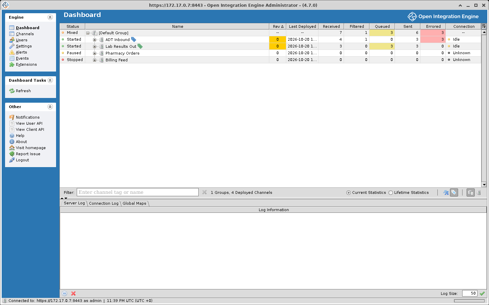
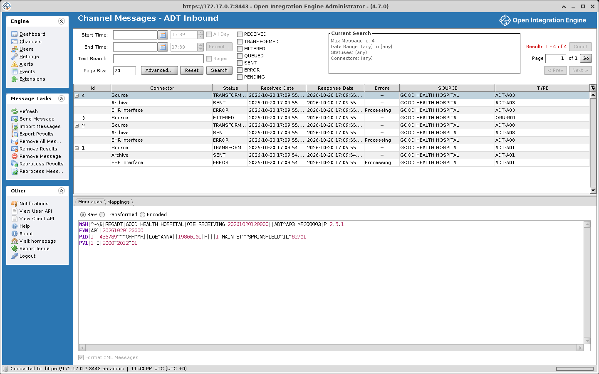
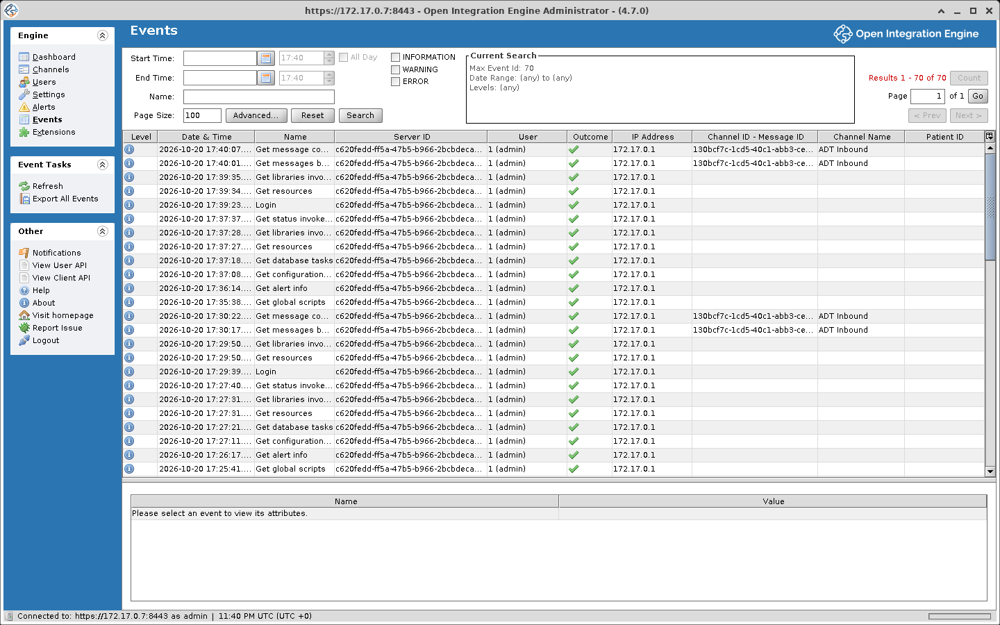

# Dashboard and Monitoring

The Dashboard is the first view you see after logging into the Administrator. It shows every deployed channel with its state, message counts, and connection activity, and has tasks to start, stop, and manage them.

## Dashboard table

The main section of the Dashboard is a table listing all deployed channels, organized under their channel groups. Each row can be expanded to reveal individual connector-level statistics.

### Dashboard columns

| Column | Description |
|---|---|
| **Status** | The channel's current state. See [Channel Statuses](#channel-statuses) below for the full list. |
| **Name** | The channel (or group) name, along with any assigned tags displayed as colored labels |
| **Rev Δ** | How many times the channel has been saved since it was last deployed. A non-zero value means there are undeployed changes. Also highlighted if linked code templates have changed. |
| **Last Deployed** | When the channel was most recently deployed. Highlighted if within the last two minutes. |
| **Received** | Messages received and accepted by the source connector |
| **Filtered** | Messages rejected by filters on the source or any destination |
| **Queued** | Messages currently sitting in a destination queue. Highlighted when greater than zero. |
| **Sent** | Messages sent by destination connectors |
| **Errored** | Messages that encountered an error anywhere in the channel. Highlighted when greater than zero. |
| **Connection** | Live activity indicator for the channel or connector. See [Connection Statuses](#connection-statuses) below. |

On a channel row, Received counts the source connector only. Filtered, Errored, and Sent add up the counts of every connector, so a message sent by three destinations adds three to Sent.

### Channel statuses

| Status | Meaning |
|---|---|
| **Deploying** | The channel is being deployed. |
| **Undeploying** | The channel is being undeployed. |
| **Starting** | The channel is starting up, possibly recovering unfinished messages. |
| **Started** | The channel is running. A green icon means all connectors are active; an orange icon means at least one connector underneath is not started. |
| **Pausing** | The source connector is shutting down while in-flight messages finish processing. |
| **Paused** | The source connector is stopped, so no new messages arrive. Queued destination messages are still sent. You can still send or reprocess messages by hand. |
| **Stopping** | The channel is shutting down. In-flight messages finish before it stops. |
| **Stopped** | The channel is not running. No messages will be received or sent. |

When a row represents a **group** rather than a single channel, the status reflects the combined state of all channels in that group. A group with no channels shows **N/A**. A group containing only Started and Starting channels shows **Starting**, only Stopped and Stopping channels shows **Stopping**, and only Paused and Pausing channels shows **Pausing**. Any other combination of states shows **Mixed**. The Dashboard can also show **Syncing** and **Unknown** for a channel.

### Connection statuses

| Status | Meaning |
|---|---|
| **Idle** | The connector is not actively processing |
| **Reading** | The source connector is reading inbound data (typical for polling connectors) |
| **Writing** | The destination connector is dispatching a message outbound |
| **Polling** | The source connector is actively polling for new data |
| **Receiving** | The source connector is receiving a message from an external system |
| **Sending** | The destination connector is transmitting outbound |
| **Waiting For Response** | The destination connector has sent a message and is awaiting a reply |
| **Connected** | The source connector has one or more active client connections. Typically includes a count of connected clients. |
| **Connecting** | The connector is establishing a connection |
| **Unknown** | No connection state is known for the connector, as on the connectors of a stopped or paused channel |

::: info
When a source connector has active client connections, the connection count is shown in parentheses after the status. If the connector has reached its maximum allowed connections, the count appears in red. Existing clients can still send, but no new connections will be accepted until one disconnects.
:::

## Dashboard tasks

The task panel on the left provides these operations when the Dashboard is active:

| Task | Description |
|---|---|
| **Refresh** | Manually reload the dashboard table. The dashboard also auto-refreshes at an interval configured in Administrator settings. |
| **Send Message** | Opens a dialog where you can type or load a message, choose which destinations to include, and optionally inject source map variables. Click **Process Message** to submit it to the selected channel. |
| **View Messages** | Opens the Message Browser for the selected channel |
| **Remove All Messages** | Deletes all stored messages and attachments for the selected channel(s) that are stopped. A channel that is not stopped is included only when you check **Include selected channels that are not stopped**. Asks you to type `REMOVEALL` when the Reprocess/remove messages confirmation setting is on, which is the default. |
| **Clear Statistics** | Resets the current statistics counters to zero for the selected channel(s) and connector(s). Only available when viewing Current Statistics. |
| **Start** | Starts or resumes the selected channel(s). Channel dependency rules may apply. |
| **Pause** | Pauses the selected channel(s) by stopping the source connector. |
| **Stop** | Gracefully stops the selected channel(s), allowing in-flight messages to finish first. |
| **Halt** | Force-stops the selected channel immediately. Only offered when a single channel is selected and it, or one of its connector rows, is Deploying, Undeploying, Starting, Stopping, Pausing, Syncing, or Unknown. Any messages mid-processing will be left incomplete and recovered on the next start. |
| **Start** and **Stop** (connector) | With a connector row selected, start or stop that connector only |
| **Undeploy Channel** | Undeploys the channel. The channel is gracefully stopped first, then disappears from the Dashboard (it remains available in the Channels view). |

## Filtering the Dashboard

### By channel name or tag

The **Filter** field at the bottom of the dashboard lets you narrow the table to specific channels:

- Start typing to see auto-complete suggestions for both tags and channel names
- Press Enter or double-click to apply a filter
- Tags show with a tag icon, channels with a channel icon
- You can stack multiple filters (tags and/or names). When multiple tags are applied, only channels matching **all** of them appear.
- Click the X next to a filter chip to remove it, or click the red X to clear everything

### By group view

Toggle the control icons in the bottom-right corner of the table to switch between showing channels organized under groups or as a flat list.

### Tag display

Tags appear as icons next to channel names by default. Use the control icons in the bottom-right to switch to colored text bubbles (**Display tags as names**), back to icons (**Display tags as icons**), or deselect both to hide tags entirely.

## Statistics

### Current vs. lifetime

- **Current Statistics**. Counts since the statistics were last reset. This is the default view.
- **Lifetime Statistics**. Cumulative totals across all deployments.

Toggle between the two using the radio buttons at the bottom of the dashboard table.

### Resetting statistics

- **Current statistics**. Select the channel and click **Clear Statistics** in the task panel
- **Lifetime statistics**. Can be reset from the Server Settings tab

## Server Log

The **Server Log** tab (below the dashboard table) shows the most recent entries logged by the running server. They are held in memory by the server, which keeps the latest 100, and are not read from the log files. Each entry includes:

- A timestamp
- A severity level: FATAL, ERROR, WARN, INFO, DEBUG, or TRACE
- The originating class/category and line number (when available)
- The log message itself

Long messages are truncated in the table. Double-click an entry to see the full text in a separate window.

Controls:
- **Log Size** (bottom-right). Adjust how many entries to keep in the tab (1 to 99, default 50). New entries push out the oldest.
- **Pause Log** button (bottom-left), which becomes **Resume Log** while paused. Freezes the log display so entries are not rotated out while you inspect them
- **X** button (bottom-left). Clears all entries currently displayed

## Connection log

The **Connection Log** tab shows a real-time, event-by-event record of connector activity as messages flow through channels. The Connection Log is held only in memory and is not written to disk.

Columns include Timestamp, Channel, Connector Info, Event (e.g. Connected, Disconnected, Sending, Idle), and Info (which typically shows socket addresses for TCP-based connectors).

The default display limit is 250 entries, adjustable up to 999 via the **Log Size** control.

## Global maps

The **Global Maps** tab displays the current contents of the Global Map and Global Channel Maps.

| Column | Description |
|---|---|
| **Server Id** | The server where the variable resides |
| **Channel** | The channel name, or `<Global Map>` for server-wide entries |
| **Key** | The variable name |
| **Value** | The current value (shown as its string representation). Double-click truncated values to see the full content. |

Select one or more channels in the dashboard table to see their channel-level map entries alongside the global ones.

## Message Browser

Open the Message Browser by selecting a channel on the Dashboard and clicking **View Messages**, or by double-clicking the channel row. You can also reach it from the Channels view.

### Metadata table

The top portion of the browser lists messages matching your search criteria. Messages are grouped by ID, with one row per connector message (source, each destination). Default columns include:

| Column | Description |
|---|---|
| **Id** | The unique message identifier within the channel |
| **Connector** | The connector name (e.g. "Source", "Destination 1") |
| **Status** | The connector message status (Received, Filtered, Transformed, Sent, Queued, Error, Pending) |
| **Received Date** | When the message was received by this connector |
| **Response Date** | When the response was recorded |
| **Errors** | Whether errors occurred: Processing, Response, Postprocessor, or Multiple |

Additional columns (Orig. Received Date, Send Attempts, Send Date, Server Id, Original Server Id, Original Id, Import Id, Import Channel Id, Channel Name) can be shown through the Column Options control. Channels with custom metadata columns will also display those columns.

### Message content

Select a connector message and use the **Messages** tab below the table to view the message at different processing stages:

| Content Type | Description |
|---|---|
| **Raw** | The original inbound message as stored after attachment extraction |
| **Processed Raw** | The message after the preprocessor script has modified it |
| **Transformed** | The internal representation of the message after the transformer has run |
| **Encoded** | The final output after deserialization into the outbound data type |
| **Sent** | The actual payload and connection properties captured just before dispatch (destination connectors only) |
| **Response** | The reply from the external system (or the generated acknowledgment) |
| **Response Transformed** | The serialized form of the response after the response transformer (destination connectors only) |
| **Processed Response** | The response in its final deserialized form (destination connectors only) |

Enable **Format XML Messages** to pretty-print XML and JSON content. This affects only the display, not the stored data.

### Mappings tab

Shows all variable map entries (scope, variable name, and value) for the selected connector message. Double-click an entry to view long values in a popup.

### Errors tab

When a connector message has a processing, postprocessor, or response error, an **Errors** tab appears with a radio button for each error type present (**Processing Error**, **Postprocessor Error**, **Response Error**) and the full stack trace.

### Attachments tab

When the message has attachments, an **Attachments** tab appears next to the Mappings tab. The **View Attachment** and **Export Attachment** tasks work on the attachment selected there.

### Message Browser Tasks

| Task | Description |
|---|---|
| **Refresh** | Reloads results within the current search window (preserves your page position and max message ID) |
| **Send Message** | Submit a test message to the current channel |
| **Import Messages** | Load previously exported XML message files into the channel's storage. Messages can be imported from the server filesystem or your local machine. |
| **Export Results** | Export all messages matching the current search to XML, with optional compression (ZIP, tar.gz, tar.bz2), encryption, and password protection |
| **Remove All Messages** | Delete all stored messages and attachments for this channel. If the channel is not stopped, its messages are removed only when you check **Include selected channels that are not stopped** |
| **Remove Results** | Delete all messages matching the current search criteria (asks you to type `REMOVEALL` when the Reprocess/remove messages confirmation setting is on, which is the default) |
| **Remove Message** | Delete a single connector message. Removing a source message also removes all its destination messages. |
| **Reprocess Results** | Re-run all messages matching the current search through the channel (asks you to type `REPROCESSALL` when the Reprocess/remove messages confirmation setting is on, which is the default) |
| **Reprocess Message** | Re-run a single message, with the option to overwrite the existing message or create a new one, and to include or exclude specific destinations |
| **View Attachment** | View an attachment in the Administrator (only available when an attachment is selected) |
| **Export Attachment** | Save an attachment to disk as binary or Base64 text |

::: info
When reprocessing a message, two source map variables are injected: `reprocessed` (always `true`) and `replaced` (indicates whether the original message was overwritten).
:::

## Event Browser

Access the Event Browser by clicking **Events** in the main navigation. It is a searchable log of user actions and system events.

### Event table columns

| Column | Description |
|---|---|
| **Level** | Severity icon: Information, Warning, or Error |
| **Date & Time** | When the event was logged |
| **Name** | The operation name or a description of the warning/error |
| **Server ID** | Which server logged the event |
| **User** | The user who performed the action, or `0 (System)` for automated events |
| **Outcome** | Success or failure indicator |
| **IP Address** | The originating client IP for user-initiated actions |
| **Channel ID - Message ID** | The associated channel and message, if applicable |
| **Channel Name** | The associated channel name, if applicable |
| **Patient ID** | For Accessed PHI events, the patient identifier (requires a PATIENT_ID custom metadata column) |

### Searching events

Filter events by date range, name text, severity level (Information, Warning, Error), and advanced criteria including user, outcome, attribute values, IP address, and server ID.

### Event tasks

- **Refresh**. Reload within the current search (preserves page position)
- **Export All Events**. Write all events to a text file in the server's exports directory

### PHI events

If a channel has a custom metadata column named `PATIENT_ID` (the name is not case-sensitive), the Message Browser logs an **Accessed PHI** event every time a user selects a connector message in that channel, and a **Queried PHI** event for every search after the first load. In the Event Browser, the Patient ID of a Queried PHI event is filled only when the search was a `PATIENT_ID` search using `=`. The Patient ID of an Accessed PHI event is empty when the message has none.
