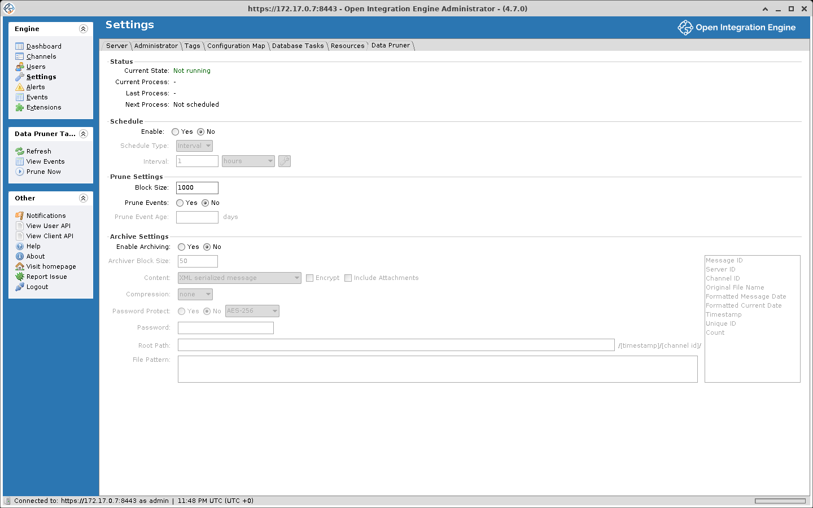

# Data Pruning and Maintenance

OIE stores message data in the database. The Data Pruner removes old message data on a schedule.

## Data Pruner

The Data Pruner is a built-in plugin that automatically removes old message data based on configurable retention policies.

### Accessing the Data Pruner
Navigate to **Settings > Data Pruner** in the Administrator.

### Global settings

| Setting | Description |
|---|---|
| **Enable** | Yes or No for the data pruner (No by default), in the **Schedule** panel |
| **Schedule Type** | When pruning runs: an interval, a daily time, or a cron expression. An interval must be at least 1 hour and under 24 hours |
| **Block Size** | Number of messages processed per pruning batch (default 1000; range 50 to 10000) |
| **Prune Events** | Yes or No for pruning of server events |
| **Prune Event Age** | Age in days of the events to prune when event pruning is on |
| **Enable Archiving** | Enable message archiving before pruning (disabled by default), in the **Archive Settings** panel |
| **Archiver Block Size** | Number of messages per archiver batch (default 50; range 1 to 1000) |
| **Include Attachments** | Include message attachments in archives (disabled by default) |



The **Archive Settings** panel also has **Content**, **Encrypt**, **Compression**, **Password Protect**, **Root Path**, and **File Pattern**. A **Status** panel shows the Current State, Current Process, Last Process, and Next Process. The task panel has **Prune Now**, **Stop Pruner**, and **View Events**.

### Per-channel pruning

Each channel has its own pruning settings in the **Message Pruning** panel on the Summary tab of the Channel Editor:

| Setting | Description |
|---|---|
| **Metadata** | **Store indefinitely**, or **Prune metadata older than** a number of days |
| **Content** | **Prune when message metadata is removed**, or **Prune content older than** a number of days (removes message content but keeps metadata). The content age cannot exceed the metadata age |
| **Allow message archiving** | Lets the Data Pruner archive this channel's messages before deletion when archiving is enabled (checked by default) |
| **Prune Errored Messages** | Include errored messages in pruning (unchecked by default) |

The pruner skips messages that are unprocessed or that have a connector message in ERROR, QUEUED, or PENDING status. Age is measured from the date the source connector received the message. **Prune Errored Messages** removes only ERROR from that list, so QUEUED and PENDING messages are still skipped.

### Pruning strategy

The pruner operates in two phases:
1. **Metadata Pruning**: Removes entire messages (metadata, content, custom metadata, attachments, and connector messages) older than the metadata retention period
2. **Content Pruning**: Removes only message content and attachments while preserving metadata, for messages older than the content retention period but newer than the metadata retention period

Metadata can be kept longer than content, for example content for 7 days and metadata for 30 days.

## Message storage modes

The storage mode set on a channel decides what is stored, and the table shows which pruning applies to each mode:

| Mode | What's Stored | Pruning Impact |
|---|---|---|
| **Development** | All content types (raw, transformed, encoded, sent, response, maps, etc.) | Largest storage footprint. Metadata and content pruning apply |
| **Production** | Raw, encoded, sent, response, and maps (excludes processed raw, transformed, response transformed, and processed response) | Moderate storage. Metadata and content pruning apply |
| **Raw** | Raw content and the source map, plus custom metadata and attachments. No other maps and no encoded, sent, or response content; message recovery and durability are disabled | Smaller storage. Metadata and content pruning apply |
| **Metadata** | Only custom metadata and attachments, no message content or maps (message recovery disabled) | Minimal storage. Metadata pruning applies |
| **Disabled** | Nothing stored | The pruner skips the channel |

Set storage mode per-channel in the channel properties.

## Manual message cleanup

### Desktop Administrator
1. Open the **Message Browser** for a channel
2. Use filters to find messages
3. Click **Remove All Messages**, **Remove Results** (everything in the current search), or **Remove Message** (the selected one)

### CLI

These commands are typed at the prompt of the CLI shell, started with `java -jar mirth-cli-launcher.jar` (see [Command Line Interface](./command_line_interface.md#launching-the-cli)). They are not operating-system commands. `clearallmessages` acts on every channel: a running channel is stopped, emptied, and started again, and statistics are kept. `resetstats` resets the current statistics of every deployed channel and its connectors. `resetstats lifetime` resets current and lifetime statistics for every channel. The shell ignores anything after `#`, so the block can be pasted as is.

```text
# Remove all messages from all channels, restarting any that are running
clearallmessages

# Reset current statistics
resetstats

# Reset current and lifetime statistics
resetstats lifetime
```

### REST API

The request below removes every message from one channel. Run it from any shell with `curl`, with `{channelId}` replaced by the channel's ID, and `<username>` and `<password>` by the account the request runs as. `-k` skips verification of the certificate the server generates for itself.

```bash
# Remove all messages from one channel, restarting it if it is running
curl -k -X DELETE \
  -H "X-Requested-With: OpenIntegrationEngine" \
  -u '<username>:<password>' \
  "https://localhost:8443/api/channels/{channelId}/messages/_removeAll?restartRunningChannels=true"
```

`restartRunningChannels` defaults to false, and then a deployed channel that is not stopped is skipped: the request succeeds and nothing is removed. With it set to true the channel is stopped, emptied, and started again. A stopped or undeployed channel is emptied either way. Leaving out `clearStatistics` keeps the channel's statistics, although the API documentation lists its default as true; add `&clearStatistics=true` to reset them. The CLI's `clearallmessages` restarts running channels and keeps statistics.

::: info
The `X-Requested-With` header is required on all API requests. Any non-empty value is accepted.
:::

## Database tasks

The **Settings > Database Tasks** panel shows available database cleanup or optimization tasks, with the columns Status, Name, Description, and Start Time. Tasks appear when applicable conditions are detected (e.g., legacy tables exist that can be removed). Select one and click **Run Task**, or **Cancel Task** to cancel it.

## Archiving

When archiving is enabled, the Data Pruner exports messages before deleting them:

- Individual messages are serialized as XML files
- Files can optionally be bundled into a `zip`, `tar.gz`, or `tar.bz2` archive
- The archive directory, file pattern, and compression format are all configurable
- Attachment inclusion is optional (disabled by default)
- Archives written in the default XML serialized message format can be imported back into a deployed channel with Import Messages in the Message Browser, with the CLI `importmessages` command, or through the message import endpoints of the REST API. A file, a folder, or an archive is accepted, and the importer reads archive entries in place

