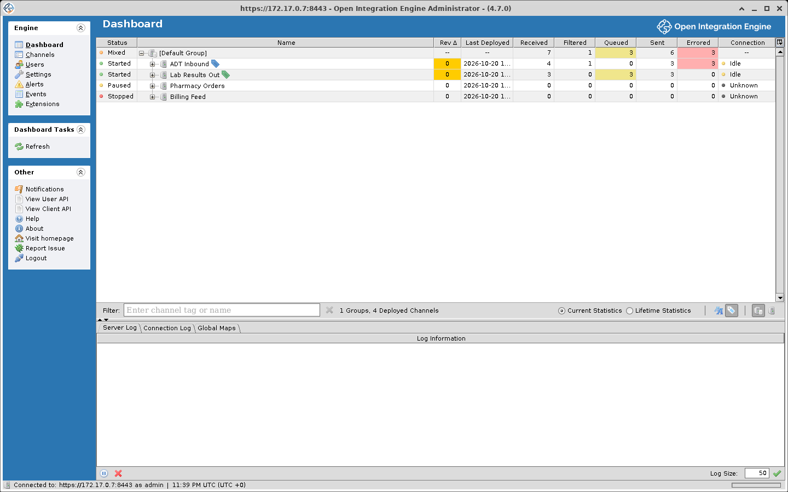
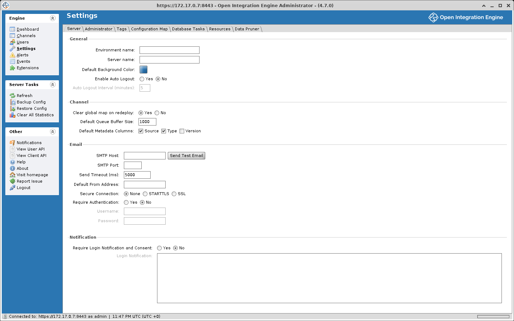

# Desktop Administrator

Starting the client and logging in are covered in [Accessing the Administrator](./accessing_the_administrator.md). The client connects over HTTPS on port `8443` by default. A status bar along the bottom of the window shows the server URL, the logged-in user, and the server time with its timezone.

The [Web Administrator](./web_administrator.md) does the same job in a browser.

## The left menu

The left side of the window is a context-sensitive menu.

| View | What it is |
|---|---|
| **Dashboard** | The first screen after logging in. Deployed channels with their state, message counts, and connection activity. Start, stop, pause, and undeploy from here, and open the [Message Browser](./dashboard_and_monitoring.md#message-browser) for a channel with **View Messages**. See [Dashboard and Monitoring](./dashboard_and_monitoring.md) |
| **Channels** | Every channel configured on the server. Create, delete, import, export, clone, enable, disable, and deploy. Channels can be grouped, and filtered by name or tag |
| **Users** | Accounts that can reach the server through either administrator, the CLI, or the REST API. See [User Management](./user_management.md) |
| **Settings** | Server-wide configuration, covered [below](#settings) |
| **Alerts** | Configured alerts with their status and how often each has fired. See [Alerts and Notifications](./alerts_and_notifications.md) |
| **Events** | A searchable log of user actions and system events, filterable by date, severity, user, and outcome, exportable to a comma-separated text file in the server's exports directory. See [the Event Browser](./dashboard_and_monitoring.md#event-browser) |
| **Extensions** | Installed plugins and connectors with their status, author, and version, and where you enable or disable them. See the [Plugin Guide](./plugins.md) |

## Channel Editor

Opening a channel from the Channels view gives you a tabbed workspace:

| Tab | Purpose |
|---|---|
| **Summary** | Name, description, data types, initial state, storage and pruning settings, tags, dependencies, and custom metadata columns |
| **Source** | The source connector and its settings |
| **Destinations** | One or more destination connectors, each with its own filter and transformer |
| **Scripts** | Channel-level Deploy, Undeploy, Preprocessor, and Postprocessor scripts |

Within Source and Destinations you can open two editors:

- **Filter Editor**, for rules (Rule Builder, JavaScript, External Script, [Iterator](./glossary.md#iterator)) joined by AND/OR. A message that matches is accepted, and one that does not is filtered.
- **Transformer Editor**, for a sequence of steps ([Mapper](./glossary.md#mapper), [Message Builder](./glossary.md#message-builder), JavaScript, External Script, XSLT Step, Iterator, [Destination Set Filter](./glossary.md#destination-set)). Dragging a field between the inbound and outbound message trees generates a mapping step.

A connector's filter and transformer are compiled into one script. A variable a filter rule assigns without `var` is still there in the transformer; one declared with `var` stays inside the rule. See [Filters and Transformers](./filters_and_transformers.md).

## Settings

The tabs cover server-wide options:

| Tab | Purpose |
|---|---|
| **Server** | Environment name and server name, both of which appear in the title bar, plus default background color, auto logout, clear global map on redeploy, default queue buffer size, default metadata columns, SMTP configuration, and login notification and consent |
| **Administrator** | UI preferences such as dashboard refresh interval and confirmation dialog behavior |
| **Tags** | Create and manage channel tags |
| **Configuration Map** | Key-value pairs readable from channel scripts at runtime |
| **Database Tasks** | Database cleanup and index tasks. See [Database tasks](./data_pruning_and_maintenance.md#database-tasks) |
| **Resources** | Custom class-path library resources available to channels |
| **Data Pruner** | Global settings for automatic message pruning |

A plugin that ships a settings panel adds its own tab here, named for the plugin.

## Other

Below the view buttons, a fixed section of the left menu is available from every view:

| Task | Description |
|---|---|
| **Notifications** | OIE release announcements from the project's GitHub repository. When there are unread items the link reads **Notifications (n)** |
| **View User API** | Opens the User API (Javadoc) in your browser |
| **View Client API** | Opens the REST API documentation in your browser |
| **Visit homepage** | Opens the OIE project repository |
| **Report Issue** | Opens the project's issue tracker |
| **Help** | Opens the OIE GitHub discussions |
| **About** | Version, build date, server ID, Java version, and third-party acknowledgements |
| **Logout** | Ends the session and returns to the login screen |

## Working with tables

Most screens present data in tables that behave the same way:

- Drag a column header to move it; adjacent columns shift.
- Right-click the header row to show or hide columns, or use the table control icon at its top right.
- Click a header to sort ascending, again for descending. Not every table sorts.
- Click the plus or minus beside a row to expand or collapse it, or right-click the header for Expand All and Collapse All.
- Shift-click for a contiguous range of rows, Ctrl-click (Cmd on macOS) for individual ones.
- Press Delete to remove a selected row, where the table allows it.
