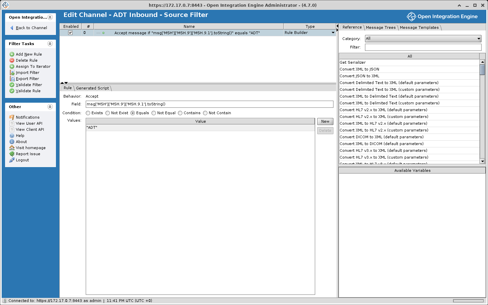
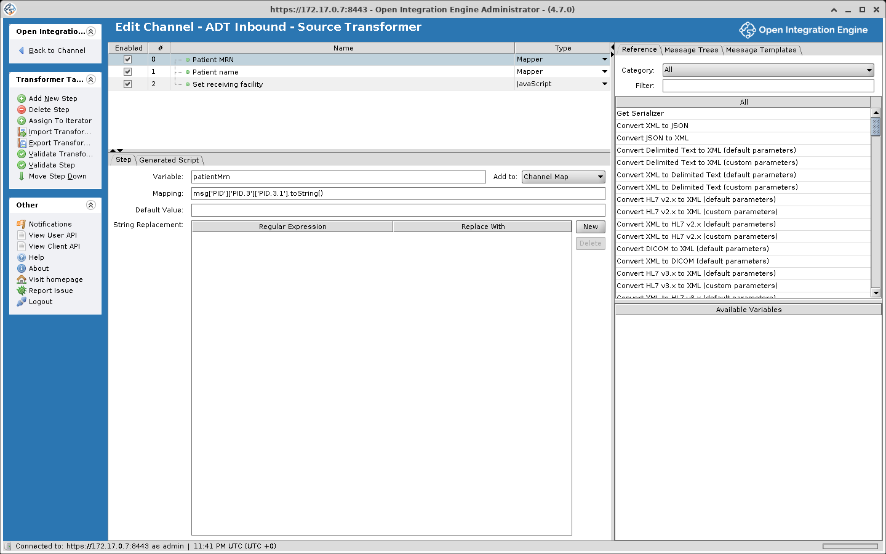

# Filters and Transformers

A filter decides whether a message goes on. A transformer runs a list of steps on the message, which usually reshape it, convert it between formats, or pull values out of it.

## About filters

Each connector has its own filter. It evaluates a message and produces a boolean result: **true** means the message is **accepted** and continues, **false** means the message is **filtered** and stops.



Both source and destination connectors can have filters:
- When a source filter filters a message, it never reaches any destination.
- When a destination filter filters a message, that particular destination skips it, but other destinations on the channel may still process it.

### Filter rules

A filter contains one or more **rules** connected by **operators**, either **AND** or **OR**. Standard boolean precedence applies, meaning AND binds more tightly than OR. For instance:

> Rule 1 **OR** Rule 2 **AND** Rule 3

is evaluated as: Rule 1 OR (Rule 2 AND Rule 3).

### The "msg" object

Before a filter runs, the engine serializes the incoming message, unless its data type is Raw, and exposes it as the **msg** variable. Depending on the data type in use, this could be an E4X XML object, a JavaScript object, or a JavaScript string. The paths on this page assume the HL7 v2.x data type, where the parsed message is XML whose elements are named by segment, field, and component, so PID.3.1 is reached as `msg['PID']['PID.3']['PID.3.1']`.

### Filter rule types

| Rule Type | Description |
|---|---|
| **Rule Builder** | A visual rule editor supporting common comparisons like equals, not equals, contains, etc. |
| **JavaScript** | Write custom logic in JavaScript. Return `true` to accept the message, `false` to filter it. |
| **External Script** | Points to a JavaScript file on the server filesystem |
| **Iterator** | Iterates over repeating segments or elements, applying child rules to each one |

#### Rule Builder example

To accept only ADT messages:
- Field: `msg['MSH']['MSH.9']['MSH.9.1'].toString()`
- Condition: Equals
- Value: `"ADT"`

Each value is a JavaScript expression, so literal text needs quotes. An unquoted `ADT` is read as a variable name, and every message errors with `ReferenceError: "ADT" is not defined`. Values are compared as text, not as regular expressions: Equals needs an exact match and Contains a substring.

#### JavaScript rule example

A JavaScript rule runs inside the filter of the connector it belongs to, source or destination, with `msg` as the parsed inbound message. This rule assumes the HL7 v2.x data type and reads the sending facility from MSH.4.1. The rule's return value is its result: `true` accepts the message, `false` filters it.

```javascript
// Accept messages from specific sending facilities
var facility = msg['MSH']['MSH.4']['MSH.4.1'].toString();
var allowedFacilities = ['HOSP_A', 'HOSP_B', 'LAB_1'];
return allowedFacilities.indexOf(facility) !== -1;
```

## About transformers

A transformer's steps usually reshape the message, change field values, convert between formats, or pull out data for later steps. Like filters, every connector has its own.



Every transformer has an **inbound data type** and an **outbound data type**. When these are the same (e.g., HL7 v2.x in and HL7 v2.x out), you are modifying a message in place. When they differ (e.g., HL7 v2.x in and JSON out), you are performing a format conversion. See [Data Types and Formats](./data_types_and_formats.md) for more.

A transformer is made up of **steps**, and each step runs as JavaScript: for example, setting a field, extracting a value, or running a script you write.

### The "msg" object

`msg` is the same as in filters.

### The "tmp" object

When a transformer has an outbound template configured, a second variable called **tmp** becomes available. It starts as that template, and the steps fill it in. For example, a transformer can read fields from `msg` (an incoming HL7 v2.x message) and place them in `tmp` (a JSON template), or copy only the fields it needs from the inbound message.

### Transformer step types

| Step Type | Description |
|---|---|
| **Mapper** | Extracts a value from the inbound message and stores it as a named variable in a selected map (defaults to the channel map) |
| **Message Builder** | Writes a value into a field of `msg` or `tmp` |
| **JavaScript** | Runs a script you write |
| **External Script** | Loads and runs a JavaScript file from the server filesystem |
| **XSLT Step** | Applies an XSLT stylesheet to a specified XML source and stores the result in the channel map |
| **Destination Set Filter** | Removes destinations from the message's destination set, so they do not receive it (source transformer only) |
| **Iterator** | Loops through repeating segments or elements, executing child steps for each iteration |

#### Mapper step

Pulls a value from the message and saves it as a variable.

| Field | Description |
|---|---|
| **Variable** | The name under which the value is stored |
| **Mapping** | The expression to evaluate (e.g. `msg['PID']['PID.3']['PID.3.1'].toString()`) |
| **Default Value** | Fallback value when the mapping returns empty. It is a JavaScript expression, so literal text needs quotes, for example `'N/A'`; an unquoted word is read as a variable name and the step errors |
| **String Replacement** | Regular Expression and Replace With fields applied to the mapped value. Both fields are JavaScript expressions, so quote them: `'[0-9]+'` and `'N'`. An unquoted regular expression is a syntax error, and the channel does not deploy |
| **Add to** | Which map to store the variable in: Channel Map (default), Connector Map, Global Channel Map, Global Map, or Response Map |

Once mapped, the variable can be accessed in JavaScript using the corresponding map object (e.g., `channelMap.get('variableName')` for Channel Map scope) and in Velocity template fields (such as File Writer paths) with `${variableName}`.

#### Message Builder step

Assigns a value to a field of `msg`, the message being processed, or of `tmp`, the outbound message.

| Field | Description |
|---|---|
| **Message Segment** | The target field in `msg` or `tmp` (drag from the message tree) |
| **Mapping** | The value to assign. Can be a literal, an expression, or a variable reference (e.g. `channelMap.get('variableName')`) |

#### JavaScript step

This step runs in a transformer with the HL7 v2.x data type on both sides and an HL7 v2.x outbound template loaded, so `tmp` exists and holds the parsed template. `msg` is the parsed inbound message. Because a template is set, the transformed message is taken from `tmp`, not `msg`. Without a template `tmp` is not defined and the step would write to `msg` instead. `DateUtil` is one of the utility classes the engine imports into every script.

```javascript
// Reformat the date of birth on its way into the outbound template
var dob = msg['PID']['PID.7']['PID.7.1'].toString();
if (dob.length === 8) {
  tmp['PID']['PID.7']['PID.7.1'] = DateUtil.convertDate('yyyyMMdd', 'yyyy-MM-dd', dob);
}
```

With a PID.7 of `19800101` the outbound message carries `1980-01-01`.

#### Iterator step

Handles repeating segments or elements:

1. Set **Iterate On** to the repeating element path
2. Add child steps (Mapper, Message Builder, JavaScript) inside the iterator
3. Use the **Index Variable** to reach the current element

## Response transformers

A response transformer exists only on destination connectors. It runs on what the destination got back after it sent, and its steps can do anything a transformer step can.

In addition to the response content itself, a destination response includes a **status** (e.g., SENT, ERROR), a **status message**, and an **error message**. A response transformer can change any of these. For example, a script that decides an ERROR response is acceptable can set the status to SENT.

::: warning A response transformer skips most failed sends unless its inbound data type is Raw
A response transformer runs only when the destination got a response back, or when the response inbound data type is Raw. A failed send usually has no response: a refused connection, an HTTP error with an empty body, and a JavaScript Writer script that throws all skip the response transformer, so error handling written there never runs for them.

With the response inbound data type set to Raw, the response transformer runs every time, response or not. `msg` is then the raw response text, so parse it yourself, for example with `JSON.parse(msg)` or `new XML(msg)`.

An HTTP error status such as 500 that comes with a body is a response: the HTTP Sender stores the body as the response, so the response transformer runs whatever the data type.
:::

## Message trees

The transformer editor provides two tree views of the message structure:

| Tree | Description |
|---|---|
| **Inbound Message Template Tree** | Built from the inbound template, a sample message that is only a reference. A field dragged from it gives its path in `msg` |
| **Outbound Message Template Tree** | Built from the outbound template, which is what `tmp` starts as. A field dragged from it gives its path in `tmp` |

### Using message trees
- **Drag and drop** fields from the inbound tree to create Mapper steps
- **Drag and drop** fields from the outbound tree to create Message Builder steps
- Clicking a field only selects it. To get its path expression, drag the field into a step or use the right-click menu
- Load sample messages to populate the tree structure

## Execution order

Within one destination chain, the filters, transformers, send, and response transformer run in this order.

```text
Source Filter Rules (in order)
    ↓ (if accepted)
Source Transformer Steps (in order)
    ↓
Destination 1 Filter Rules (in order)
    ↓ (if accepted; otherwise the chain continues with Destination 2)
Destination 1 Transformer Steps (in order)
    ↓
Destination 1 Connector sends message
    ↓
Destination 1 Response Transformer Steps (in order)
    ↓
Destination 2 Filter Rules, Transformer Steps, send, Response Transformer Steps
    ↓
Every later destination in the chain, in the same order
```

Destination 2 waits for Destination 1 only when the two share a chain. A destination with **Wait for previous destination** checked, which is the default, joins the chain of the destination above it; one with it unchecked starts a new chain, and chains run at the same time. See [Destination chains](./threading_and_ordering.md#destination-chains). When a destination queues the message instead of sending it on the processing thread, the chain moves on at once, and the send and the response transformer run later on a queue thread. See [Destination queues](./queueing.md#destination-queues).
