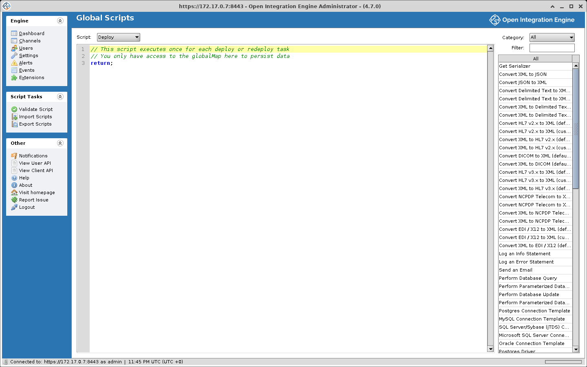

# Global Scripts

Global scripts are server-wide deploy, undeploy, preprocessor, and postprocessor scripts. The deploy and undeploy scripts run once per deploy or undeploy operation. The preprocessor and postprocessor run for every message on every channel. The channel scripts of the same names belong to one channel.

## Accessing global scripts

1. In the Administrator, navigate to **Channels** in the main menu
2. Click **Edit Global Scripts** in the task panel
3. The Global Scripts editor opens with a **Script** selector for Deploy, Undeploy, Preprocessor, and Postprocessor



## Available objects

The engine builds a fresh scope for every run of a global script, and what it contains depends on the script type. The deploy and undeploy scripts run outside any channel, so nothing channel-scoped or message-scoped exists in them. The preprocessor and postprocessor run inside a channel for one message. The table lists each object, what it is, and which global scripts have it.

| Object | Description | Scripts |
|---|---|---|
| `globalMap` | Server-wide variable map shared by every channel. A `get` followed by a `put` is not atomic | All |
| `configurationMap` | Server configuration key-value pairs | All |
| `logger` | Log4j logger named `deploy`, `undeploy`, `preprocessor`, or `postprocessor`, all at DEBUG in the shipped `log4j2.properties` | All |
| `router` | VMRouter for sending messages to other channels | All |
| `replacer` | TemplateValueReplacer for variable substitution | All |
| `DatabaseConnectionFactory` | Factory for creating database connections. The engine never closes a connection a script opened | All |
| `contextFactory` | Access to the current JavaScript context, for example the custom resource IDs it uses | All |
| `channelId` | ID of the current channel | Preprocessor, postprocessor |
| `channelName` | Name of the current channel | Preprocessor, postprocessor |
| `globalChannelMap` | Per-channel map shared by every thread of that channel | Preprocessor, postprocessor |
| `alerts` | AlertSender for triggering alerts | Preprocessor, postprocessor |
| `message` | The raw message as a String in the preprocessor; an ImmutableMessage in the postprocessor | Preprocessor, postprocessor |
| `connectorMessage` | ImmutableConnectorMessage for the source connector | Preprocessor |
| `connector` | Name of the source connector | Preprocessor |
| `destinationSet` | DestinationSet for keeping the current message away from chosen destinations | Preprocessor |
| `sourceMap` | Source map | Preprocessor, postprocessor |
| `connectorMap` | Connector map of the source connector, writable | Preprocessor |
| `channelMap` | Channel map. Writable in the preprocessor, read-only in the postprocessor, where `put` throws `UnsupportedOperationException` | Preprocessor, postprocessor |
| `responseMap` | Response map, writable in the preprocessor. In the postprocessor `put` does not throw: it writes to the merged copy the scope was built from, and the engine copies that map into the source connector's response map after this script runs | Preprocessor, postprocessor |
| `response` | The `Response` returned by the channel postprocessor, or null when it returned nothing | Postprocessor |
| `RECEIVED`, `FILTERED`, `TRANSFORMED`, `SENT`, `QUEUED`, `ERROR`, `PENDING` | Status constants for building a `Response` | Postprocessor |

Every script is also compiled with the shorthand functions `$g` (globalMap), `$gc` (globalChannelMap), `$cfg` (configurationMap), `$c` (channelMap), `$co` (connectorMap), `$s` (sourceMap), and `$r` (responseMap). One argument gets a value, two arguments put one. Each shorthand needs its map to exist in the scope, so `$c` fails in the deploy and undeploy scripts.

## Script types

### Global deploy script
Runs once per deploy operation, whatever set of channels is being deployed, before any channel deploy script. When the set includes a channel that is already deployed, the operation is a redeploy: the channel undeploy scripts run, then the global undeploy script, then the global deploy script, then the channel deploy scripts. An exception thrown here is logged and the deploy continues.

The sample runs in the global deploy scope: `globalMap`, `configurationMap`, `logger`, and the other server-wide objects from the table, but no `channelName`, `channelId`, or `globalChannelMap`, so a logger line here carries no channel prefix. It puts one value in the global map, where every channel script can read it afterwards with `globalMap.get` or `$g`, and writes a deploy-time line to the `deploy` logger.

```javascript
globalMap.put('facilityCode', 'HOSP1');
logger.info('Global deploy: facilityCode = ' + globalMap.get('facilityCode'));
```

### Global undeploy script
Runs once at the end of every undeploy operation, after the channel undeploy scripts, and once inside every deploy operation that includes an already-deployed channel, before the global deploy script. Undeploying or redeploying a single channel runs it while every other channel stays deployed, so anything it removes from the global map or closes is gone for the channels still running, unless the global deploy script puts it back. Every channel is down when it runs on Redeploy All, at server shutdown, or when every channel is undeployed at once. Redeploy All is the path that also clears the global map between the undeploy and deploy phases when the server setting **Clear global map on redeploy** is Yes (the engine treats an unset value as Yes). The scope is the same as the global deploy scope. An exception thrown here is logged and the operation continues.

### Global preprocessor script
Runs once for every message on every channel, before the channel preprocessor, on the source connector message. The scope has `message` as the raw message String, `channelName`, `channelId`, `connectorMessage`, the writable `connectorMap`, `channelMap`, and `responseMap`, and the read-only `sourceMap`, from the table.

The string this script returns is the `message` the channel preprocessor receives. A script that ends without a `return` leaves the message unchanged. To change the message, return the modified string.

Do not log per message. The `preprocessor` logger is at DEBUG in the shipped configuration, so every line reaches `mirth.log` and the Server Log panel with no message context. A per-message fact belongs in the channel map, which is writable here and is shown with the message in the Message Browser. The sample records that it ran and returns the message unchanged.

```javascript
channelMap.put('globalPreprocessor', 'ran');
return message;
```

### Global postprocessor script
Runs once for every message on every channel, after the channel postprocessor. The scope has `message` as an ImmutableMessage, `channelId`, `response`, the status constants, and the maps from the table. `channelMap` is read-only here, so `channelMap.put` throws `UnsupportedOperationException`. It reads the maps, and it can return a `Response`.

`response` is the `Response` the channel postprocessor returned, or null when that script returned nothing. Returning a `Response` from this script replaces it, returning nothing keeps it, and any other non-null value is wrapped as a `SENT` Response with that value as its message. The result is stored in the source connector's response map under the key `Postprocessor`, which the source connector sends back to the sender when its response is set to Postprocessor. `Response` is `com.mirth.connect.userutil.Response`, imported into every script scope, and `SENT` is one of the status constants in the postprocessor scope.

```javascript
return new Response(SENT, 'processed');
```

## Global scripts vs. channel scripts

| Aspect | Global Scripts | Channel Scripts |
|---|---|---|
| **Scope** | All channels on the server | Single channel only |
| **Execution order** | Global preprocessor runs first; global postprocessor runs last | Channel scripts run between global scripts |
| **Editing** | Edit Global Scripts view | Channel editor Scripts tab |

### Execution order
```text
Global Preprocessor
  → Channel Preprocessor
    → Source Filter/Transformer
      → Destination chains (each destination: filter/transformer, send, response transformer)
    → Channel Postprocessor
  → Global Postprocessor
```

## Import / export

Global scripts can be imported and exported via the CLI:

```text
importscripts "path"
    Imports global scripts from file

exportscripts "path"
    Exports global scripts to file
```

Scripts are also included when exporting the full server configuration (`exportcfg`).

