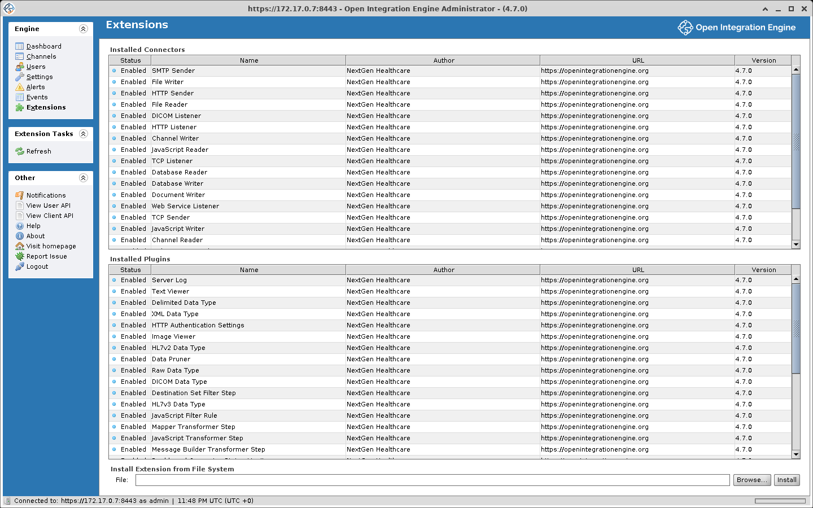

# OIE Plugin Guide

Plugins add connectors, data types, filter and transformer steps, and Administrator screens to Open Integration Engine (OIE). Resources for developing plugins are under [Developing extensions](#developing-extensions).

## Accessing the extensions/plugins section

To manage plugins in Open Integration Engine:

1. Launch and log in to the **OIE Administrator Client**
2. Select **Extensions** from the **Engine** sidebar menu
3. You will see a list of all installed plugins along with their status and other details.



This screen installs, enables, disables and uninstalls extensions. It is not where an
extension is configured. A plugin that ships a settings panel adds its own tab under
**Engine** > **Settings**, named by the plugin, and that is where its configuration lives.

Most of what looks like core functionality is an extension, loaded the same way as a
third-party plugin: the connectors, the data types, the filter and transformer steps, the
attachment viewers, and MLLP framing all ship as extensions and appear in this list.

Community extensions are cataloged at [openintegrationengine.org/plugins](https://openintegrationengine.org/plugins/).

## Installing plugins

### Installing via the Administrator UI

To install a plugin through the Administrator:

1. Download the plugin `.zip` file from a trusted source
2. Launch and log in to the **OIE Administrator Client**
3. Select **Extensions** from the **Engine** sidebar menu
4. Click the **Browse** button
5. Locate and select the plugin `.zip` file
6. Click **Open**
7. Click **Install**
8. **Restart** the OIE Server and the Administrator for the plugin to take effect

### Manual installation

For environments where UI-based installation is not feasible, you can install plugins manually:

1. Stop the OIE Server
2. Extract the plugin `.zip` file
3. Copy the extracted plugin folder to the `extensions/` directory in your OIE installation. In these samples `/opt/oie` and `C:\Program Files\OIE` stand for wherever OIE is installed:
   ::: code-group
   ```bash [Linux/macOS]
   cp -r my-plugin /opt/oie/extensions/
   ```
   ```powershell [Windows]
   Copy-Item -Recurse my-plugin "C:\Program Files\OIE\extensions\"
   ```
   :::
4. **(Linux/macOS only)** Ensure proper file permissions so the OIE process can read the plugin files. The plugin files should be owned by the same user that runs OIE:
   ::: code-group
   ```bash [Linux/macOS]
   # Replace 'oie' with the user account that runs the OIE Server
   chown -R oie:oie /opt/oie/extensions/my-plugin
   ```
   :::
   ::: tip
   OIE does not create a dedicated system user during installation. It runs as the user who starts the service. Check which user owns your OIE installation directory or runs the OIE process.
   :::
5. Start the OIE Server

### Installing in the OIE Docker container

The `openintegrationengine/engine:latest` image on Docker Hub runs Open Integration Engine 4.5.2, a technology preview, not 4.7.0. No 4.6.0 or 4.7.0 image is published.

A plugin can be installed in a Docker container in three ways:

#### Example 1: Docker CLI with `custom-extensions` volume mount

Mount a host directory containing plugin zip files to the container's `custom-extensions` directory. The container's entrypoint script will unzip and install them to the `extensions` directory prior to launching the server. The Administrator connects on port 8443:

```bash
docker run -d \
  -p 8443:8443 \
  -v /path/to/local/custom-extensions:/opt/engine/custom-extensions \
  openintegrationengine/engine:latest
```

Before it starts the server, the entrypoint prints `Found N custom extensions.`, with N the number of zip files, but only when it found at least one. If `docker logs` on the container shows no such line, the mounted directory held no `.zip` files.

#### Example 2: Custom Dockerfile with manual installation

Extract the plugin `.zip` file on the build host and copy the folder into the image's `extensions/` directory. The base image runs as the `engine` user and owns everything under `/opt/engine`, so the copied files are given to the same user:

::: code-group
```dockerfile [Dockerfile]
FROM openintegrationengine/engine:latest

COPY --chown=engine:engine my-plugin/ /opt/engine/extensions/my-plugin/
```
:::

Build and run:

```bash
docker build -t oie-with-plugins .
docker run -d -p 8443:8443 oie-with-plugins
```

#### Example 3: Docker Compose with `EXTENSIONS_DOWNLOAD` URL

The container supports downloading a bundle of extensions from a remote web server and installing them prior to launching the server. The bundle file is a zip file that contains one or more extension zip files to be installed. The extension zips must sit at the top level of the bundle; the entrypoint only unzips `*.zip` files directly inside the extracted bundle, and zips nested in a folder are ignored:

::: code-group
```yaml [compose.yaml]
services:
  oie:
    image: openintegrationengine/engine:latest
    environment:
      - EXTENSIONS_DOWNLOAD=https://my-bucket.s3.us-east-1.amazonaws.com/my-oie-extensions-bundle.zip
    ports:
      - "8080:8080"
      - "8443:8443"
```
:::

A failed download is not fatal. The entrypoint prints `problem with extensions download` and starts the server with no extensions installed, so check `docker logs` for that line when the extensions are missing.

## Uninstalling plugins

### Via the Administrator UI

1. Select **Extensions** from the **Engine** sidebar menu
2. Select the extension you want to remove in the **Installed Connectors** or **Installed Plugins** table
3. Select **Uninstall Extension** from the **Extension Tasks** menu
4. Confirm the uninstallation when prompted
5. **Restart** the OIE Server and the Administrator

### Manual uninstallation

1. Stop the OIE Server
2. Navigate to the `extensions/` directory
3. Remove the plugin folder:
   ::: code-group
   ```bash [Linux/macOS]
   rm -rf /opt/oie/extensions/my-plugin
   ```
   ```powershell [Windows]
   Remove-Item -Recurse -Force "C:\Program Files\OIE\extensions\my-plugin"
   ```
   :::
4. Start the OIE Server

Deleting the folder removes the code only. **Uninstall Extension** in the Administrator also queues removal of the extension's saved properties and any database uninstall statements the plugin supplies, and the server applies both at the next start.

## Enabling and disabling plugins

You can temporarily disable plugins without uninstalling them:

### To disable a plugin

1. Select **Extensions** from the **Engine** sidebar menu
2. Select the extension in the **Installed Connectors** or **Installed Plugins** table
3. Select **Disable Extension** from the **Extension Tasks** menu
4. **Restart** the OIE Server and the Administrator

### To enable a plugin

1. Select **Extensions** from the **Engine** sidebar menu
2. Select the disabled extension in the **Installed Connectors** or **Installed Plugins** table
3. Select **Enable Extension** from the **Extension Tasks** menu
4. **Restart** the OIE Server and the Administrator

::: tip
If you suspect a plugin is causing issues, disable it and restart the server to confirm.
:::

## Plugin compatibility and version requirements

### Checking compatibility

Before installing a plugin, verify:

1. **OIE Version**: Check the plugin documentation for supported OIE versions
2. **Java Version**: Some plugins may require specific Java versions

::: info
A plugin declares the server versions it supports in `<mirthVersion>`, as a comma-separated list of exact versions. A version range is not supported. On OIE 4.7.0 the list must include `4.7.0`: a plugin built only for 4.6.0 is refused at install, and one already in `extensions/` is not loaded at startup, which `logs/mirth.log` reports as `is not compatible with this version`.
:::

## Troubleshooting common issues

### Plugin not appearing after installation

**Possible causes and solutions:**

1. **Server or Administrator not restarted**: Restart both after installation
2. **Incorrect directory**: Verify the plugin is in the correct `extensions/` folder
3. **File permissions**: Ensure the OIE process has read access to the plugin files
4. **Corrupted archive**: Re-download and reinstall the plugin

### Plugin causing server startup failures

If the server fails to start after installing a plugin:

1. Check the server log in `logs/mirth.log` for error messages
2. Try starting the server with the plugin disabled:
   ::: code-group
   ```bash [Linux/macOS]
   # Move the plugin out of extensions; the server loads only folders inside it
   mv /opt/oie/extensions/problem-plugin /opt/oie/
   ```
   ```powershell [Windows]
   # Move the plugin out of extensions; the server loads only folders inside it
   Move-Item "C:\Program Files\OIE\extensions\problem-plugin" "C:\Program Files\OIE\"
   ```
   :::
3. If the server then starts, the plugin caused the failure

### Plugin features not working

1. Verify the extension shows **Enabled** in the **Status** column under **Engine** > **Extensions**
2. Review server logs for runtime errors
3. Check `logs/mirth.log` for `could not locate library`, which the server logs at startup for each server or shared library that an enabled, compatible extension declares but does not ship. Client libraries are not checked

### Common error messages

| Error | Cause | Solution |
|-------|-------|----------|
| `ClassNotFoundException` | A library the plugin declares in its metadata is missing from its folder | Look for `could not locate library` in `logs/mirth.log` and restore the file it names |
| `NoSuchMethodError` | The plugin was built against a different version of a class than the engine ships | Install a build of the plugin for this engine version |

## Developing extensions

### Extension directory structure

Each extension lives in its own subdirectory under `OIE_HOME/extensions/`. Connectors
describe themselves with `source.xml`, `destination.xml`, or both, depending on which
sides they provide, while plugins and data types use `plugin.xml`. A connector folder can
carry a `plugin.xml` as well, as the TCP connectors do for the service plugin they need.

```text
extensions/
├── http/                         # Connector example
│   ├── http-server.jar           # Server-side classes
│   ├── http-client.jar           # Client-side classes (downloaded to the Administrator)
│   ├── http-shared.jar           # Shared classes (loaded on both sides)
│   ├── source.xml                # Source connector metadata
│   └── destination.xml           # Destination connector metadata
└── datapruner/                   # Plugin example
    ├── datapruner-server.jar
    ├── datapruner-client.jar
    ├── datapruner-shared.jar
    └── plugin.xml                # Plugin metadata descriptor
```

Some extensions also carry a `lib/` subdirectory for third-party dependencies.
Client-only extensions, such as the Mapper and Rule Builder steps, ship no server jar
at all.

### Extension metadata

A metadata descriptor declares:

- Extension name, author, and version
- Server-side and client-side class names
- Library JAR paths and their type (server, client, or shared)
- API provider classes, meaning servlet interfaces and their implementations

### Server-side extension points

| Extension Type | Class/Interface |
|---|---|
| **Server Plugin** | `ServerPlugin` (interface) |
| **Service Plugin** | `ServicePlugin` (interface, extends ServerPlugin) |
| **Channel Plugin** | `ChannelPlugin` (interface, extends ServerPlugin) |
| **Data Type** | `DataTypeServerPlugin` (abstract class) |
| **Resource Plugin** | `ResourcePlugin` (interface, extends ServerPlugin) |
| **Library Plugin** | `LibraryPlugin` (interface, extends ResourcePlugin) |
| **Authorization Plugin** | `AuthorizationPlugin` (interface, extends ServerPlugin) |
| **Transmission Mode** | `TransmissionModeProvider` (abstract class, implements ServerPlugin) |
| **Code Template Plugin** | `CodeTemplateServerPlugin` (interface, extends ServerPlugin) |
| **Multi-Factor Auth Plugin** | `MultiFactorAuthenticationPlugin` (abstract class, implements ServicePlugin) |

All ten live in `com.mirth.connect.plugins`.

### Building an extension

1. Produce the server-side, client-side, or shared JARs the extension needs
2. Write the metadata descriptor (`plugin.xml`, or `source.xml` and `destination.xml` for connectors)
3. Package it into the extension directory layout
4. Test against a running OIE instance

An extension's server half works the same for the
[Desktop Administrator](./desktop_administrator.md) and the
[Web Administrator](./web_administrator.md). Its Swing client classes do not run in
the Web Administrator. To give an extension a browser interface, build a web half
against the REST endpoints the extension already exposes and put it in a `webadmin/`
folder inside the same extension zip. OIE 4.7.0 does not serve that folder itself;
the [Web Support](https://github.com/gibson9583/oie-web-support-plugin) extension
does. The web extension points, the manifest format and the build are documented in
[PLUGINS.md](https://github.com/gibson9583/oie-web-client/blob/main/web-administrator/PLUGINS.md)
in the web client repository.

### Resources

- **Plugin Author's Guide**: [mirth-plugin-guide](https://github.com/kpalang/mirth-plugin-guide) - An unofficial collection of tips and tricks for Mirth Connect plugins. Several sections are marked "To be fleshed out". It does not mention OIE or BridgeLink.
- **Sample Plugin**: [mirth-sample-plugin](https://github.com/kpalang/mirth-sample-plugin) - A sample plugin project for NextGen Connect, built against Mirth 4.5.0, best used as a template. It does not mention OIE or BridgeLink.

## See also

- [Contributing to Open Integration Engine](./contributing.md)
- [OIE Docker Hub](https://hub.docker.com/u/openintegrationengine)
- [OIE GitHub Repository](https://github.com/OpenIntegrationEngine/engine)
