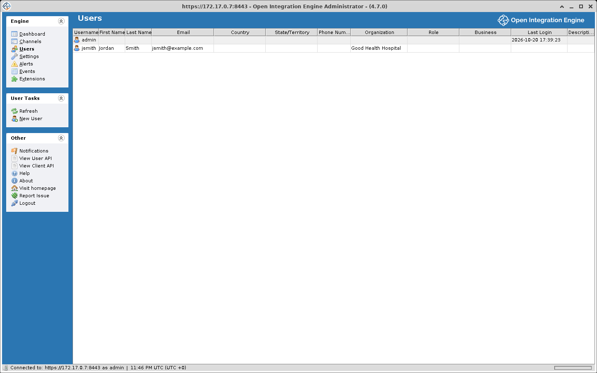

# User Management

OIE maintains its own user accounts for anyone who needs to log in, whether through either administrator, the Command Line Interface, or the REST API. The Users view lets you create, edit, and remove these accounts. Role-based access control is available as a [community extension](https://openintegrationengine.org/plugins/) for restricting specific operations to designated user roles.

A password, including the admin account's, is reset in the Edit User dialog with **New Password** and **Confirm New Password**, or from the [Command Line Interface](./command_line_interface.md) with `user changepw`. The CLI logs in first, and its shipped config file contains `user=admin` and `password=admin`, which do not match the admin password a new database generates (see [Configuration](./command_line_interface.md#configuration)).

## Default account

A new database starts with one account, `admin`. [Initial admin password](./accessing_the_administrator.md#initial-admin-password) covers how it gets its first password. A database that already exists keeps its accounts and passwords.

## Users view

Open the Users view by clicking **Users** in the main navigation panel. The table displays all user accounts on the server.



### Users table columns

| Column | Description |
|---|---|
| **Username** | The login name (must be unique) |
| **First Name** | The user's given name |
| **Last Name** | The user's family name |
| **Email** | The user's email address. This is the address used when an alert sends notifications to this user. |
| **Country** | Country of residence |
| **State/Territory** | State or territory (for users in the United States) |
| **Phone Number** | Contact phone number |
| **Organization** | The user's organization or company |
| **Role** | Their role within the organization (e.g. Employee - Engineer, Independent Contractor) |
| **Business** | The industry or field they work in (e.g. HIE, Hospital, Lab) |
| **Last Login** | Date and time of the most recent successful login. A REST API request authenticated with HTTP Basic does not update it |
| **Description** | An optional free-text description or notes field |

## Managing user accounts

### Creating a new user

1. Click **New User** in the task panel
2. Fill in the required fields (marked with a red asterisk):
   - **Username**
   - **New Password**
   - **Confirm New Password**
3. Optionally fill in the remaining profile fields: First Name, Last Name, Email, Country, State/Territory, Phone, Organization, Role, Business, Description
4. Click **Finish**

::: info
Both password fields must match exactly. The username must not already exist in the system.
:::

### Editing a user

1. Select the user in the table
2. Click **Edit User** in the task panel (or double-click the user row)
3. Modify any fields as needed. The Username field is editable, but the new name must be unique
4. Click **Finish**

### Deleting a user

1. Select the user in the table
2. Click **Delete User** in the task panel
3. Confirm the deletion when prompted

### User tasks summary

| Task | Description |
|---|---|
| **Refresh** | Reload the users table |
| **New User** | Open the new user dialog |
| **Edit User** | Open the selected user for editing |
| **Delete User** | Remove the selected user from the server |

## Password policy

Password requirements are controlled through properties in `conf/mirth.properties`. The shipped file sets `password.minlength = 15`, `password.retrylimit = 100` and `password.lockoutperiod = 1`, so a password needs at least 15 characters and lockout is on: the 101st consecutive failed login locks the account for an hour. Every other key ships at `0`, which turns its check off, and a key missing from the file is read as `0`. The server reads these properties once, when it starts, so a change takes effect at the next restart.

| Property | Description | Default |
|---|---|---|
| `password.minlength` | Minimum number of characters | `15` |
| `password.minupper` | Minimum uppercase letters (-1 = none allowed) | `0` |
| `password.minlower` | Minimum lowercase letters (-1 = none allowed) | `0` |
| `password.minnumeric` | Minimum digits (-1 = none allowed) | `0` |
| `password.minspecial` | Minimum special characters (-1 = none allowed) | `0` |
| `password.retrylimit` | Consecutive failed logins allowed before the account locks. With `5` the sixth failure locks it (0 = no lockout) | `100` |
| `password.lockoutperiod` | Hours the account stays locked. The failure count is also cleared once this many hours pass after the last failed login. With `0` the account never locks, whatever `password.retrylimit` says | `1` |
| `password.expiration` | Days until the password expires (0 = never) | `0` |
| `password.graceperiod` | Days the user can still log in after the password expires, counted from the first login after expiry. Each of those logins asks for a new password (0 = unlimited, -1 = no grace, the login is refused) | `0` |
| `password.reuseperiod` | A password set within this many days cannot be set again (0 = no limit, -1 = never again) | `0` |
| `password.reuselimit` | Times a password already in the user's history may be set again (0 = no limit, -1 = never again) | `0` |

A special character is one of ``! " # $ % & ' ( ) * + , / : ; < = > ? @ [ ] ^ _ ` ~``. A space, hyphen, period, backslash, `{`, `|`, and `}` do not count.

### Example

The password requirements section of `conf/mirth.properties` with a policy set:

```properties
password.minlength = 15
password.minupper = 1
password.minlower = 1
password.minnumeric = 1
password.minspecial = 1
password.retrylimit = 5
password.lockoutperiod = 1
password.expiration = 90
password.graceperiod = 7
password.reuseperiod = 0
password.reuselimit = -1
```

With these values a new password needs at least 15 characters including an uppercase letter, a lowercase letter, a digit, and a special character, and any password in the user's history is rejected with "You cannot reuse the same password." While both reuse keys are `0`, as shipped, each password change clears the older history, so the history starts with the password in place when this policy takes effect. The sixth consecutive failed login locks the account for an hour; while it is locked, a login is refused before the password is checked and the message says how long remains. The password expires 90 days after it was set. For seven days from the first login after that, the login still succeeds and the user is asked to change the password. After that the login is refused until an administrator sets a new password, for example with `user changepw`.

## First login

The first time each user logs in, the Administrator opens a welcome dialog that asks for a new password, which must meet the [password policy](#password-policy), and for the user's account details. [First login](./accessing_the_administrator.md#first-login) walks through it.

## Username behavior

Usernames are case-insensitive by default: `Admin`, `admin`, and `ADMIN` all refer to the same account.
