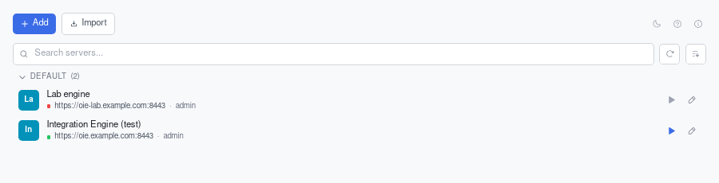
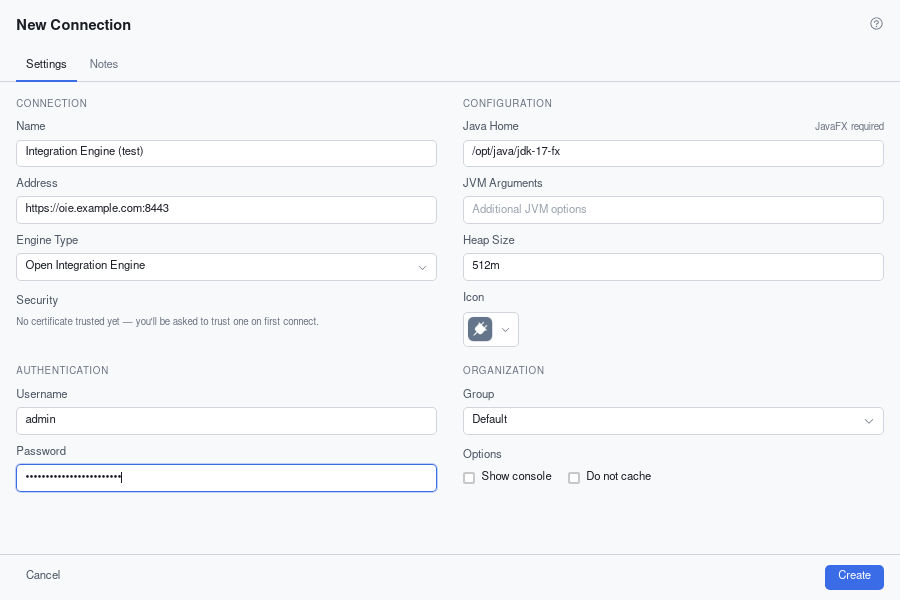

# Launchers

Launcher is the launcher known to work with the current Administrator, and it is maintained.

## Launcher

https://github.com/diridium-com/launcher

Launcher is a fork of Ballista, built with the [Tauri framework](https://tauri.app/) and licensed under MPL-2.0. It includes
a Java console output viewer, server TLS certificate verification with trust management,
and real-time server connectivity status, and it can import existing connections from the Mirth Connect Administrator Launcher's (MCAL's)
`data/connections.json`. Installers are published for macOS, Windows and Linux.

[Accessing the Administrator](../engine/accessing_the_administrator.md#launcher) shows how to add a connection and start the Administrator.

::: tip Windows Defender
Windows Defender may flag Launcher as a false positive. Other antivirus products do not.
:::
